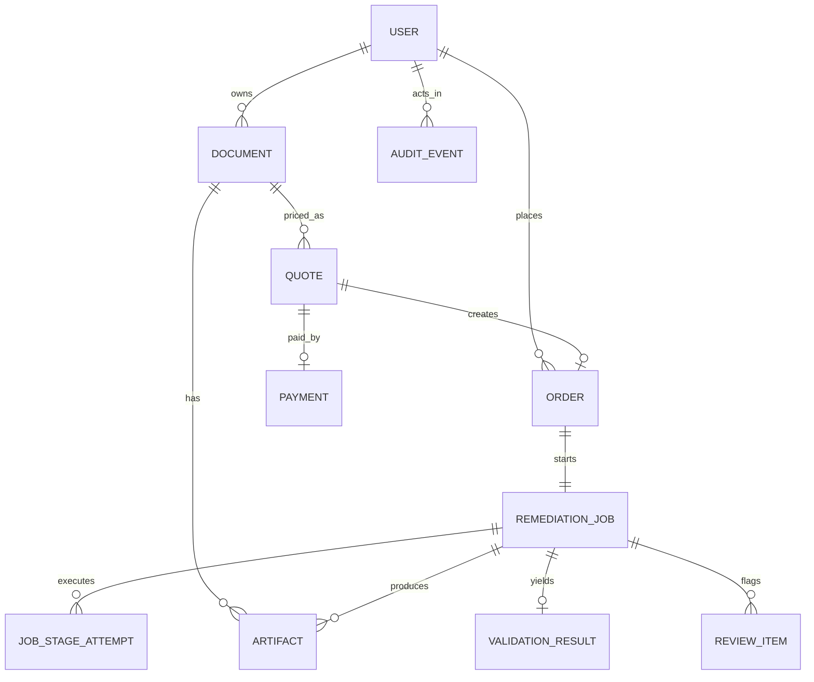
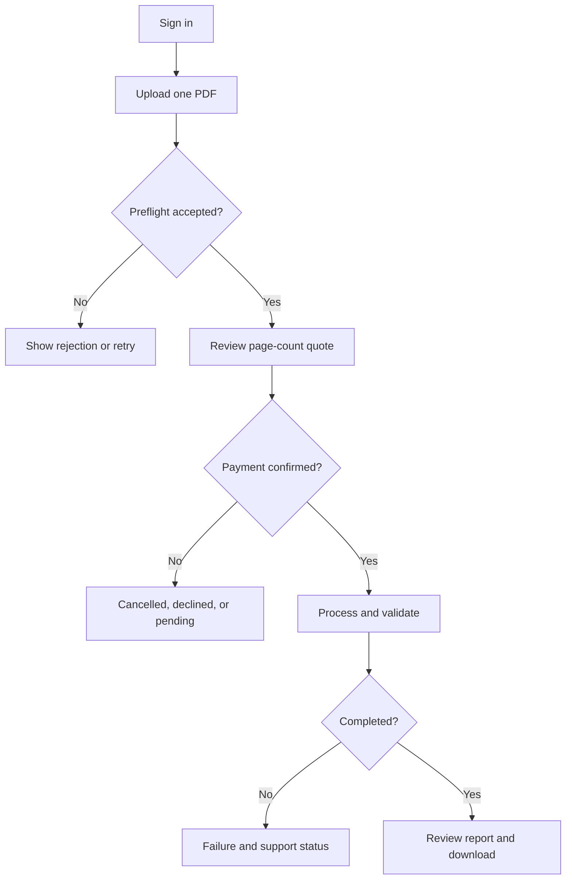

# PDF Remediation Service — Product Requirements Document

**Document status:** Draft for stakeholder review  
**Target platform:** .NET  
**Delivery team:** Two junior developers  
**Target schedule:** Eight weeks  
**Primary audience:** Government staff who publish or maintain PDF documents

## 1. Summary

PDF Remediation Service is a paid web application for government staff who need to improve the accessibility of PDF documents without changing their visible appearance. A customer uploads one PDF, sees a price calculated from its page count, pays, and receives a remediated PDF plus a machine-readable and human-readable processing report. The MVP uses Mistral OCR 4.1 for page and document understanding, a vendor-neutral accessibility intermediate representation (IR), PDFix Enterprise to modify the original PDF, and veraPDF to validate machine-verifiable PDF/UA requirements. The service reports validation and confidence results but does not promise that automated output is fully ADA, WCAG, or PDF/UA conformant without human review.

## 2. Problem Statement

Government organizations publish born-digital, scanned, and mixed PDFs. Many files lack a usable tag tree, correct reading order, table semantics, list structure, alternative text, language metadata, or searchable text. Manual remediation requires specialized knowledge and does not scale well for routine document volumes.

Existing automated products demonstrate that PDFs can be auto-tagged, but the source research states that auto-tagging is not the same as accessibility compliance. Machine validators can confirm technical rules while still missing incorrect headings, weak alternative text, illogical reading order, or inaccurate table relationships. Doing nothing leaves inaccessible content in publication workflows, increases manual remediation effort, and leaves government customers without a repeatable way to measure or improve PDF accessibility.

The commercial opportunity is a per-page service. The variable OCR cost identified in the source is approximately $0.004 per page. PDFix Enterprise is expected to use a fixed or instance-based commercial license, while veraPDF has no per-page license cost. This cost shape could support a customer price materially above the direct processing cost, subject to final vendor quotes and payment fees.

## 3. Goals / Non-Goals

### Goals

- Accept one customer PDF per order.
- Determine and display the page count before payment.
- Calculate the order amount as `page count × configured price per page`.
- Collect payment before starting paid remediation.
- Preserve the original visible page content.
- Support born-digital, scanned, and mixed PDFs through a page-aware processing pipeline.
- Use Mistral OCR 4.1 to identify text blocks, structural labels, geometry, confidence, and reading order.
- Normalize model output into a vendor-neutral accessibility IR owned by the product.
- Use PDFix Enterprise to add or modify accessibility information in the original PDF.
- Validate the output with veraPDF.
- Return the remediated PDF and a report that distinguishes technical validation, visual preservation, semantic confidence, and manual-review recommendations.
- Record enough stage-level data to diagnose failures without logging customer document content.

### Non-Goals

- The MVP will not guarantee that every output is ADA compliant, WCAG 2.1 AA conformant, or PDF/UA conformant.
- The MVP will not replace human accessibility review for low-confidence or complex content.
- The MVP will not include an in-browser PDF tag-tree editor or manual remediation workstation.
- The MVP will not process multiple uploaded PDFs in one order.
- The MVP will not expose a public bulk-processing API.
- The MVP will not self-host GLM-OCR, PaddleOCR-VL, DeepSeek-OCR, Docling, or MinerU.
- The MVP will not use Adobe Auto-Tag as its production remediation engine.
- The MVP will not build a PDF tagging engine directly on Apache PDFBox.
- The MVP will not embed PAC 2026 in the hosted service.
- The MVP will not include a human-verified paid tier.
- The MVP will not recreate a PDF from Markdown, HTML, or model-generated page content.

## 4. Success Criteria

| ID | Criterion | Measurement |
|---|---|---|
| SC-01 | A customer can complete the primary path. | Upload, quote, payment, processing, report, and download succeed in an end-to-end test. |
| SC-02 | Pricing is deterministic. | For every accepted test file, displayed subtotal equals persisted page count multiplied by the active per-page price in cents. |
| SC-03 | Unpaid jobs do not consume paid remediation services. | No Mistral or PDFix stage begins until the payment record is in `Paid` state. |
| SC-04 | Visible content is preserved. | Input and output pages rendered by the same renderer at the same resolution produce a pixel mismatch ratio of `0.0000`; any non-zero result is reported and prevents a `Completed` status. |
| SC-05 | Technical validation is reported honestly. | Every completed job includes the veraPDF profile, pass/fail result, rule-failure count, and raw report artifact. |
| SC-06 | Low-confidence work is visible. | Every block below the configured confidence threshold creates a review item with page number, type, and confidence. |
| SC-07 | Variable OCR cost is observable. | Each completed Mistral stage records pages submitted and estimated OCR cost using the configured provider rate; the source baseline is `$0.004/page`. |
| SC-08 | Failure handling is testable. | Automated tests cover invalid PDF, payment failure, Mistral timeout, PDFix failure, veraPDF failure, and unavailable download. |
| SC-09 | The customer interface is accessible. | MVP screens pass automated WCAG 2.1 AA checks and a documented keyboard-only test of the primary path. |
| SC-10 | The eight-week release is supportable. | A new operator can use the runbook to identify a failed stage, retry an eligible job, or issue the documented manual fallback within 15 minutes. `[ASSUMPTION]` |

## 5. Users & Roles

| Role | Capabilities | Permission boundaries |
|---|---|---|
| Customer | Create an account, upload one PDF, view its quote, pay, view job status, download owned artifacts, and delete owned files before automatic expiration. `[ASSUMPTION]` | Can access only records and files linked to their own user ID. Cannot change prices, retry internal stages, see provider payloads, or access another customer's order. |
| Service Operator | View all jobs, stage status, non-content error summaries, validation results, and audit events; retry eligible failed jobs; mark a job for refund handling. `[ASSUMPTION]` | Cannot view payment credentials. Document download access is disabled by default and requires a separately logged support action. `[ASSUMPTION]` |
| Service Administrator | All operator capabilities plus configure price per page, confidence threshold, file limits, retention period, and integration enablement. `[ASSUMPTION]` | Cannot alter the amount or page count of an already-created quote. Cannot mark a payment as paid without a verified provider event. |
| Background Worker | Read paid queued jobs, access source artifacts, call processing integrations, write derived artifacts, and update stage status. `[ASSUMPTION]` | Has no interactive login and no ability to change pricing or user data. |

## 6. Scope

| Area | MVP | Phase 2 | Explicitly Out of Scope |
|---|---|---|---|
| Customer workflow | Account, single PDF upload, page-count quote, payment, status, report, download | Saved payment methods, order history filters, organization accounts | Anonymous public processing `[ASSUMPTION]` |
| Pricing | One configurable per-page price; one currency `[ASSUMPTION]` | Volume tiers, contracts, coupons, tax calculation, minimum charges | Negotiated enterprise billing in the MVP |
| Document input | Born-digital, scanned, and mixed PDFs; one file per order | Batch ZIP, portfolio PDFs, public API | Non-PDF input |
| Understanding | Mistral OCR 4.1 blocks, labels, confidence, and reading order | GLM-OCR, PaddleOCR-VL, Docling, MinerU, ensemble routing | LayoutParser-based primary pipeline |
| Remediation | PDFix Enterprise applied to the original PDF | Compare PDFix, Apryse, and Foxit; optional PDFBox engine | Rebuilding pages from HTML or Markdown |
| Validation | veraPDF, custom confidence rules, pixel comparison | Adobe checker, PAC-assisted QA, semantic second-pass model, NVDA/JAWS test service | Claiming machine validation replaces human review |
| Accessibility structures | Headings, paragraphs, lists, tables, figures, artifacts, reading order, document title/language when the IR provides them | Interactive corrections, advanced formula/MathML review, table repair UI | Human-authored remediation in the MVP |
| Service tiers | Automated remediation | Complex-document pricing, verified human review, bulk/API, government annual plans | Human review bundled into every MVP order |
| Operations | Single deployment with one or more licensed workers `[ASSUMPTION]` | Autoscaling and multi-region operation | Unlicensed elastic PDFix worker creation |

## 7. User Stories & Acceptance Criteria

### 7.1 Account and Access

#### US-01 — Create and use a customer account

*As a customer, I want to sign in to a private account, so that only I can access my documents, orders, and downloads.*

**Depends on:** FR-01, FR-02, FR-21

**Acceptance criteria**

1. **Given** a visitor is not authenticated, **when** the visitor opens an upload or job URL, **then** the application redirects to sign-in and preserves only a safe local return path.
2. **Given** a customer is authenticated, **when** the customer opens the dashboard, **then** only that customer's jobs are listed.
3. **Given** Customer A knows Customer B's job identifier, **when** Customer A requests Customer B's status, report, or download URL, **then** the application returns `404` and records an authorization-denied audit event without revealing that the job exists.
4. **Given** a sign-in attempt fails, **when** the page returns, **then** no document data is shown and the page displays a generic authentication error.

### 7.2 Upload and Preflight

#### US-02 — Upload a PDF

*As a customer, I want to upload one PDF, so that the service can inspect it and calculate a price.*

**Depends on:** FR-03, FR-04, FR-05, FR-20

**Acceptance criteria**

1. **Given** an authenticated customer selects a valid PDF within configured limits, **when** upload completes, **then** the application creates a document record, stores the original artifact, and starts preflight.
2. **Given** a file extension is not `.pdf`, **when** upload is attempted, **then** the application rejects it before storage and explains that only PDF files are accepted.
3. **Given** a file is named `.pdf` but does not begin with a valid PDF signature or cannot be parsed, **when** preflight runs, **then** the document is marked `Rejected`, no quote is created, and the customer sees a non-technical error.
4. **Given** a PDF exceeds either the configured byte or page limit, **when** preflight runs, **then** the document is marked `Rejected`, no paid processing begins, and the actual and allowed limits are shown.
5. **Given** preflight cannot read page count, **when** the parser fails, **then** the customer sees a retry option and no amount is charged.

#### US-03 — Review a page-count quote

*As a customer, I want to see the page count and price before paying, so that I can decide whether to continue.*

**Depends on:** FR-06, FR-07, FR-08

**Acceptance criteria**

1. **Given** preflight succeeds, **when** the quote page loads, **then** it shows filename, page count, unit price, currency, subtotal, quote expiration, and a statement that automated remediation does not guarantee compliance.
2. **Given** the configured price is `P` cents and the file contains `N` pages, **when** a quote is created, **then** its amount is exactly `P × N` cents using integer arithmetic.
3. **Given** an administrator changes the price after a quote is created, **when** the customer views the existing unexpired quote, **then** its stored unit price and total do not change.
4. **Given** a quote has expired, **when** the customer attempts checkout, **then** checkout is blocked and the customer must create a new quote using the current price.
5. **Given** pricing is not configured or payment processing is disabled, **when** preflight completes, **then** no payable quote is produced and the customer sees that ordering is temporarily unavailable.

### 7.3 Payment

#### US-04 — Pay for an order

*As a customer, I want to pay the quoted amount, so that remediation can start.*

**Depends on:** FR-09, FR-10, FR-11, FR-12

**Acceptance criteria**

1. **Given** an unexpired unpaid quote, **when** the customer selects pay, **then** the application creates one payment-provider checkout for the exact stored amount and currency.
2. **Given** the payment provider sends a valid signed success event, **when** the event is processed, **then** the payment becomes `Paid`, an order is created or confirmed, and exactly one remediation job is queued.
3. **Given** the customer returns from checkout before the provider event arrives, **when** the status page loads, **then** it displays `Confirming payment` and does not start remediation.
4. **Given** payment is cancelled or declined, **when** the customer returns, **then** the quote remains unpaid, no remediation job starts, and the customer can retry payment while the quote is valid.
5. **Given** the same valid provider event is delivered more than once, **when** later copies are processed, **then** no duplicate charge record, order, or remediation job is created.
6. **Given** a provider event has an invalid signature or mismatched amount/currency, **when** it is received, **then** the event is rejected, no job is queued, and an operator alert is recorded.

### 7.4 Remediation Processing

#### US-05 — Process a paid PDF

*As a customer, I want my paid PDF processed without changing its visible pages, so that I receive a more accessible version of the same document.*

**Depends on:** FR-13, FR-14, FR-15, FR-16, FR-17, FR-18, FR-19

**Acceptance criteria**

1. **Given** a payment is `Paid` and no job exists for the order, **when** the queue action commits, **then** one job enters `Queued` state.
2. **Given** a queued job, **when** a worker claims it, **then** only that worker can execute the current attempt and the job moves to `Preprocessing`.
3. **Given** a born-digital page, **when** preprocessing completes, **then** the system retains native text/object references and produces a page render for model analysis.
4. **Given** an image-only page, **when** preprocessing completes, **then** the system marks the page as scanned and prepares it for OCR text-layer and tag generation.
5. **Given** a mixed PDF, **when** preprocessing completes, **then** classification is stored per page rather than once for the whole document.
6. **Given** preprocessing succeeds, **when** Mistral is called, **then** block geometry, text, reading order, labels, and available confidence values are normalized into the IR.
7. **Given** the IR is valid, **when** PDFix remediation runs, **then** it edits accessibility structures in a copy of the original PDF and does not regenerate visible pages.
8. **Given** a provider or worker timeout occurs, **when** the attempt ends, **then** the stage is recorded as transiently failed and retried according to INT-01 or INT-02 without creating another charge.
9. **Given** the IR cannot be mapped to source objects or PDFix reports an unrecoverable file error, **when** remediation stops, **then** the job becomes `Failed`, the original file remains unchanged, and the customer sees that no output was produced.

#### US-06 — Track job status

*As a customer, I want to see the current processing stage, so that I know whether to wait, download, or seek support.*

**Depends on:** FR-22, FR-23

**Acceptance criteria**

1. **Given** a job is active, **when** its status page is open, **then** it displays one of: `Queued`, `Analyzing`, `Remediating`, `Validating`, or `Preparing results`.
2. **Given** a stage changes, **when** the client refreshes or polls within 15 seconds, **then** the displayed status matches the persisted customer-facing status. `[ASSUMPTION]`
3. **Given** no jobs exist, **when** the customer opens the dashboard, **then** an empty state links to upload.
4. **Given** status retrieval fails, **when** the page cannot load current data, **then** the last known state is not presented as current and a retry control is shown.
5. **Given** a job fails, **when** the status page loads, **then** it displays a customer-safe failure category, payment/refund handling status, and support reference ID without exposing stack traces or provider secrets.

### 7.5 Validation and Results

#### US-07 — Receive validation results

*As a customer, I want to understand what automation verified and what still needs review, so that I do not mistake an automated result for a compliance guarantee.*

**Depends on:** FR-24, FR-25, FR-26, FR-27

**Acceptance criteria**

1. **Given** PDFix produces an output PDF, **when** veraPDF validation completes, **then** the report records the validation profile, pass/fail status, and every reported rule failure.
2. **Given** input and output renders are compared, **when** any pixel differs, **then** visual preservation is `Fail`, the job does not become `Completed`, and the output is not offered as a completed result.
3. **Given** any IR element is below the configured confidence threshold, **when** the report is built, **then** it lists a review item with page number, element type, confidence, and reason.
4. **Given** veraPDF passes and visual preservation passes, **when** semantic review items remain, **then** the result says `Manual review recommended` rather than `Compliant`.
5. **Given** veraPDF fails, **when** the report is shown, **then** the customer can see the number and categories of technical failures and the output is labeled `Validation failed`.
6. **Given** no review items exist, **when** the report is shown, **then** it still states that automated checks do not guarantee ADA, WCAG, or PDF/UA compliance.

#### US-08 — Download result artifacts

*As a customer, I want to download the remediated PDF and report, so that I can review and publish the result.*

**Depends on:** FR-28, FR-29, FR-30

**Acceptance criteria**

1. **Given** a job is `Completed`, **when** the customer selects download PDF, **then** the application authorizes ownership and returns the remediated PDF with a safe filename and `application/pdf` content type.
2. **Given** a report exists, **when** the customer selects download report, **then** the application returns JSON containing the job summary, validation summary, visual-diff result, confidence summary, and review items.
3. **Given** the artifact retention date has passed, **when** the customer requests a download, **then** the application returns `410 Gone`, explains that the file expired, and does not expose the storage path.
4. **Given** an artifact record exists but its file is missing, **when** download is requested, **then** the application returns a customer-safe error, records an operational error, and does not mark the job as newly failed.
5. **Given** an incomplete or failed job, **when** the customer requests a remediated PDF URL directly, **then** the application returns `404`.

### 7.6 Failure Recovery and Operations

#### US-09 — Retry a transient processing failure

*As a service operator, I want to retry an eligible failed stage without charging the customer again, so that transient vendor or infrastructure failures can recover.*

**Depends on:** FR-31, FR-32, FR-33

**Acceptance criteria**

1. **Given** a job failed with a retryable category and has attempts remaining, **when** an operator selects retry, **then** a new stage attempt is queued against the same job and order.
2. **Given** a job failed due to invalid input, an IR validation error, or a visual-diff failure, **when** the operator opens the job, **then** retry is disabled unless the underlying implementation or configuration changed and the operator records a reason. `[ASSUMPTION]`
3. **Given** the retry action is submitted twice, **when** both requests are handled, **then** at most one active retry attempt is created.
4. **Given** all retry attempts fail, **when** the last attempt closes, **then** the job remains `Failed`, the customer sees the failure state, and refund handling is flagged for manual action.

#### US-10 — Configure commercial and processing settings

*As a service administrator, I want to configure pricing and processing limits, so that orders use an explicit approved policy.*

**Depends on:** FR-34, FR-35, FR-36

**Acceptance criteria**

1. **Given** an administrator enters a positive integer price in cents, **when** it is saved, **then** new quotes use it and existing quotes are unchanged.
2. **Given** an administrator enters zero, a negative number, or a fractional cent, **when** save is attempted, **then** validation fails.
3. **Given** an administrator changes a confidence threshold, **when** a new job begins, **then** that job stores and uses the new value while existing jobs retain their stored value.
4. **Given** a non-administrator requests the settings page or endpoint, **when** authorization runs, **then** access is denied and an audit event is recorded.
5. **Given** any production-critical integration is disabled or lacks configuration, **when** an administrator views health status, **then** the integration is identified as unavailable without displaying its secret value.

#### US-11 — Audit an order and job

*As a service operator, I want a timestamped event history, so that I can explain what happened without reading the customer's document content.*

**Depends on:** FR-37, FR-38

**Acceptance criteria**

1. **Given** an upload, quote, payment event, stage transition, retry, download, configuration change, or deletion occurs, **when** it commits, **then** an audit event records actor, action, target identifier, UTC timestamp, and correlation ID.
2. **Given** a provider returns document text or image data, **when** application logs are written, **then** that content is not present in structured logs.
3. **Given** an operator searches by support reference or job ID, **when** a match exists, **then** the event timeline is displayed in timestamp order.
4. **Given** no match exists, **when** search completes, **then** an empty result is shown without an application error.

## 8. Functional Requirements

| ID | Requirement | Related stories |
|---|---|---|
| FR-01 | The system shall authenticate each interactive customer before allowing upload, order, status, report, or download access. `[ASSUMPTION]` | US-01 |
| FR-02 | The system shall authorize every customer data request by the authenticated user's ID and return `404` for another customer's resource. `[ASSUMPTION]` | US-01 |
| FR-03 | The system shall accept exactly one file per upload operation. | US-02 |
| FR-04 | The system shall accept only files whose extension, media type, signature, and parser result identify a PDF. `[ASSUMPTION]` | US-02 |
| FR-05 | The system shall persist the original PDF unchanged and record its SHA-256 hash before preflight. `[ASSUMPTION]` | US-02 |
| FR-06 | The system shall determine page count before creating a payable quote. | US-03 |
| FR-07 | The system shall calculate quote total in integer minor currency units as `page count × unit price`. | US-03 |
| FR-08 | The system shall store the quote's page count, unit price, currency, total, creation time, and expiration time so later price changes do not alter it. `[ASSUMPTION]` | US-03 |
| FR-09 | The system shall create payment checkout only for an unexpired unpaid quote. | US-04 |
| FR-10 | The system shall treat a signed payment-provider event, not the browser return, as payment confirmation. `[ASSUMPTION]` | US-04 |
| FR-11 | The system shall reject payment events with invalid signature, unknown provider ID, duplicate event ID, or mismatched amount/currency. `[ASSUMPTION]` | US-04 |
| FR-12 | The system shall create at most one remediation job per paid order. | US-04 |
| FR-13 | The system shall start Mistral or PDFix processing only after the related payment status is `Paid`. | US-05 |
| FR-14 | The system shall classify each page as born-digital, scanned, or mixed before semantic processing. `[ASSUMPTION]` | US-05 |
| FR-15 | The system shall render each input page at one configured resolution using one pinned renderer version for later model input and visual comparison. `[ASSUMPTION]` | US-05 |
| FR-16 | The system shall submit page content to Mistral OCR 4.1 and request block-level output that includes available text, labels, bounding boxes, reading order, and confidence. | US-05 |
| FR-17 | The system shall normalize Mistral output into the Accessibility IR and shall validate the IR against a versioned schema before PDFix execution. | US-05 |
| FR-18 | The system shall preserve native text/object references for born-digital content and shall use OCR-derived accessible text only for image-only regions. | US-05 |
| FR-19 | The system shall use PDFix Enterprise to modify a copy of the original PDF's accessibility structures rather than recreate visible pages. | US-05 |
| FR-20 | The system shall reject files outside configured byte or page limits before payment. `[ASSUMPTION]` | US-02 |
| FR-21 | The system shall isolate customer data by user and use non-sequential public identifiers. `[ASSUMPTION]` | US-01 |
| FR-22 | The system shall map internal stages to customer-facing states: `Queued`, `Analyzing`, `Remediating`, `Validating`, `Preparing results`, `Completed`, or `Failed`. `[ASSUMPTION]` | US-06 |
| FR-23 | The system shall make persisted job status available to the owner without exposing provider payloads or stack traces. | US-06 |
| FR-24 | The system shall run veraPDF against every PDFix output before completion. | US-07 |
| FR-25 | The system shall render and compare every input and output page with identical settings and record pixel mismatch count and ratio. | US-07 |
| FR-26 | The system shall create review items for IR elements below the job's stored confidence threshold and for validation failures. | US-07 |
| FR-27 | The system shall never label an automated output `ADA compliant`, `WCAG compliant`, or `PDF/UA compliant` solely because automated checks pass. | US-07 |
| FR-28 | The system shall provide the owner a downloadable remediated PDF only after technical validation and visual comparison finish. | US-08 |
| FR-29 | The system shall provide the owner a downloadable JSON processing report. | US-08 |
| FR-30 | The system shall stop downloads after the artifact expiration timestamp and shall delete expired artifact bytes through a scheduled cleanup process. `[ASSUMPTION]` | US-08 |
| FR-31 | The system shall classify failures as retryable or non-retryable. `[ASSUMPTION]` | US-09 |
| FR-32 | The system shall prevent more than one active processing attempt for the same stage and job. `[ASSUMPTION]` | US-09 |
| FR-33 | The system shall allow an operator to retry eligible failures without creating a new order or charge. `[ASSUMPTION]` | US-09 |
| FR-34 | The system shall allow an administrator to configure a positive whole-cent price per page and one ISO 4217 currency. `[ASSUMPTION]` | US-10 |
| FR-35 | The system shall snapshot active processing settings onto a job when the job is queued. `[ASSUMPTION]` | US-10 |
| FR-36 | The system shall expose health state for the database, artifact storage, payment adapter, Mistral adapter, PDFix worker, and veraPDF executable without exposing secrets. `[ASSUMPTION]` | US-10 |
| FR-37 | The system shall create append-only audit events for security, commercial, processing, download, retry, configuration, and deletion actions. `[ASSUMPTION]` | US-11 |
| FR-38 | The system shall assign one correlation ID to each request and carry the job correlation ID through background stages and integration calls. `[ASSUMPTION]` | US-11 |

## 9. Data Model

### 9.1 Data requirements

| ID | Requirement |
|---|---|
| DR-01 | All primary keys shall be UUIDs generated by the application or database. `[ASSUMPTION]` |
| DR-02 | All timestamps shall be stored as UTC with timezone-aware database types. `[ASSUMPTION]` |
| DR-03 | Monetary amounts shall be stored as integer minor units; floating-point types are prohibited. `[ASSUMPTION]` |
| DR-04 | Original PDF, rendered pages, Accessibility IR, remediated PDF, raw validator output, and customer report shall be stored as artifacts outside relational row data. `[ASSUMPTION]` |
| DR-05 | Artifact rows shall store SHA-256, byte length, media type, storage key, creation time, and expiration time. `[ASSUMPTION]` |
| DR-06 | The Accessibility IR shall include a schema version and stable element IDs. |
| DR-07 | Each IR element shall support page, semantic type, bounding box, reading order, text when applicable, confidence when available, source-object references when available, parent ID, and semantic properties. |
| DR-08 | Table IR shall support rows, columns, `TH`/`TD`, header scope, row span, and column span. |
| DR-09 | List IR shall support `L`, `LI`, `Lbl`, and `LBody` relationships. |
| DR-10 | Figure IR shall support decorative status and alternative text when generated or supplied. |
| DR-11 | Payment-provider secrets and full payment instrument data shall never be stored in the application database. `[ASSUMPTION]` |
| DR-12 | Audit events shall be append-only to application roles; corrections shall be new events. `[ASSUMPTION]` |
| DR-13 | Jobs, quotes, and payments shall retain the exact configuration values used for their execution. `[ASSUMPTION]` |

### 9.2 Entities and fields

#### `User`

| Field | Type | Null | Rules |
|---|---|---:|---|
| `Id` | UUID | No | Primary key. |
| `Email` | string(320) | No | Normalized unique index. `[ASSUMPTION]` |
| `Role` | enum | No | `Customer`, `Operator`, or `Administrator`. |
| `CreatedAtUtc` | timestamp | No | Set once. |
| `DisabledAtUtc` | timestamp | Yes | Disabled users cannot authenticate. |

#### `Document`

| Field | Type | Null | Rules |
|---|---|---:|---|
| `Id` | UUID | No | Primary key and public non-sequential ID. |
| `OwnerUserId` | UUID | No | Foreign key to `User`. |
| `OriginalArtifactId` | UUID | Yes | Required after upload succeeds. |
| `OriginalFileName` | string(255) | No | Strip path components and control characters. `[ASSUMPTION]` |
| `Sha256` | char(64) | Yes | Lowercase hexadecimal after storage. |
| `ByteLength` | long | Yes | Positive. |
| `PageCount` | int | Yes | Positive after preflight. |
| `PreflightStatus` | enum | No | `Uploaded`, `Inspecting`, `Accepted`, `Rejected`, `Failed`. |
| `RejectionCode` | string(50) | Yes | Required when status is `Rejected`. |
| `CreatedAtUtc` | timestamp | No | Set once. |
| `ExpiresAtUtc` | timestamp | No | Derived from active retention setting. `[ASSUMPTION]` |

#### `Quote`

| Field | Type | Null | Rules |
|---|---|---:|---|
| `Id` | UUID | No | Primary key. |
| `DocumentId` | UUID | No | Foreign key to accepted `Document`. |
| `PageCount` | int | No | Snapshot; must equal accepted count at creation. |
| `UnitPriceMinor` | int | No | Positive whole number. |
| `Currency` | char(3) | No | ISO 4217 uppercase. `[ASSUMPTION]` |
| `TotalMinor` | long | No | Must equal page count × unit price. |
| `Status` | enum | No | `Open`, `CheckoutPending`, `Paid`, `Expired`, `Cancelled`. |
| `CreatedAtUtc` | timestamp | No | Set once. |
| `ExpiresAtUtc` | timestamp | No | Later than creation. |

#### `Payment`

| Field | Type | Null | Rules |
|---|---|---:|---|
| `Id` | UUID | No | Primary key. |
| `QuoteId` | UUID | No | Unique foreign key to `Quote`. `[ASSUMPTION]` |
| `Provider` | string(50) | No | Provider identifier; final value pending OQ-03. |
| `ProviderCheckoutId` | string(255) | Yes | Unique when present. |
| `ProviderPaymentId` | string(255) | Yes | Unique when present. |
| `AmountMinor` | long | No | Must equal quote total. |
| `Currency` | char(3) | No | Must equal quote currency. |
| `Status` | enum | No | `Pending`, `Paid`, `Failed`, `RefundPending`, `Refunded`. |
| `PaidAtUtc` | timestamp | Yes | Required only for paid/refund states. |
| `LastProviderEventId` | string(255) | Yes | Used with provider-event table or unique constraint for idempotency. `[ASSUMPTION]` |

#### `Order`

| Field | Type | Null | Rules |
|---|---|---:|---|
| `Id` | UUID | No | Primary key. |
| `QuoteId` | UUID | No | Unique foreign key. |
| `PaymentId` | UUID | No | Unique foreign key to paid payment. |
| `OwnerUserId` | UUID | No | Denormalized authorization key. `[ASSUMPTION]` |
| `CreatedAtUtc` | timestamp | No | Created only after confirmed payment. |

#### `RemediationJob`

| Field | Type | Null | Rules |
|---|---|---:|---|
| `Id` | UUID | No | Primary key and support reference. |
| `OrderId` | UUID | No | Unique foreign key; one job per order. |
| `DocumentId` | UUID | No | Foreign key. |
| `Status` | enum | No | Internal state machine defined below. |
| `CurrentStage` | enum | Yes | `Preflight`, `Render`, `Ocr`, `NormalizeIr`, `Remediate`, `Validate`, `VisualDiff`, `Report`. |
| `IrSchemaVersion` | string(20) | No | Example: `1.0`. `[ASSUMPTION]` |
| `ConfidenceThreshold` | decimal(5,4) | No | Range `0.0000–1.0000`; snapshot. |
| `RenderDpi` | int | No | Snapshot; default pending OQ-10. |
| `MistralRatePerPage` | decimal(10,6) | No | Source baseline `0.004000`. |
| `EstimatedOcrCost` | decimal(12,4) | Yes | Page count × stored rate. |
| `CorrelationId` | string(64) | No | Indexed. |
| `FailureCategory` | string(50) | Yes | Customer-safe mapped category. |
| `QueuedAtUtc` | timestamp | No | Set once. |
| `StartedAtUtc` | timestamp | Yes | First worker claim. |
| `CompletedAtUtc` | timestamp | Yes | Terminal state only. |

**Internal job states:** `Queued`, `Preprocessing`, `OcrRunning`, `IrReady`, `Remediating`, `Validating`, `Comparing`, `Reporting`, `Completed`, `Failed`, `Cancelled`.

#### `JobStageAttempt`

| Field | Type | Null | Rules |
|---|---|---:|---|
| `Id` | UUID | No | Primary key. |
| `JobId` | UUID | No | Foreign key. |
| `Stage` | enum | No | Same stage list as job. |
| `AttemptNumber` | int | No | Starts at 1; unique with job and stage. |
| `Status` | enum | No | `Queued`, `Running`, `Succeeded`, `Failed`. |
| `Retryable` | bool | Yes | Required on failure. |
| `ProviderRequestId` | string(255) | Yes | Diagnostic ID only; no secret. |
| `ErrorCode` | string(100) | Yes | Sanitized. |
| `StartedAtUtc` | timestamp | Yes | UTC. |
| `EndedAtUtc` | timestamp | Yes | UTC. |

#### `Artifact`

| Field | Type | Null | Rules |
|---|---|---:|---|
| `Id` | UUID | No | Primary key. |
| `DocumentId` | UUID | No | Foreign key. |
| `JobId` | UUID | Yes | Null for original upload. |
| `Kind` | enum | No | `OriginalPdf`, `PageRender`, `AccessibilityIr`, `RemediatedPdf`, `VeraPdfReport`, `VisualDiff`, `CustomerReport`. |
| `StorageKey` | string(1024) | No | Unique; never sent to customers. |
| `MediaType` | string(100) | No | Required. |
| `ByteLength` | long | No | Non-negative. |
| `Sha256` | char(64) | No | Lowercase hexadecimal. |
| `CreatedAtUtc` | timestamp | No | Set once. |
| `ExpiresAtUtc` | timestamp | No | Indexed for cleanup. |
| `DeletedAtUtc` | timestamp | Yes | Set after byte deletion. |

#### `ValidationResult`

| Field | Type | Null | Rules |
|---|---|---:|---|
| `Id` | UUID | No | Primary key. |
| `JobId` | UUID | No | Unique foreign key. |
| `Profile` | string(100) | No | Exact configured veraPDF profile. |
| `Passed` | bool | No | Machine-verifiable result only. |
| `FailureCount` | int | No | Non-negative. |
| `RawReportArtifactId` | UUID | No | Foreign key to artifact. |
| `VisualMismatchPixels` | long | No | Non-negative. |
| `VisualTotalPixels` | long | No | Positive. |
| `VisualMismatchRatio` | decimal(12,8) | No | `mismatch / total`. |
| `ManualReviewRecommended` | bool | No | True when any review item exists. |

#### `ReviewItem`

| Field | Type | Null | Rules |
|---|---|---:|---|
| `Id` | UUID | No | Primary key. |
| `JobId` | UUID | No | Foreign key. |
| `PageNumber` | int | Yes | One-based when page-specific. |
| `ElementId` | string(100) | Yes | IR element reference. |
| `Type` | enum | No | `LowConfidence`, `ComplexTable`, `ReadingOrder`, `AltText`, `Heading`, `ValidationFailure`, `VisualDifference`, `Other`. |
| `Confidence` | decimal(5,4) | Yes | Range `0–1`. |
| `Code` | string(100) | No | Stable machine-readable reason. |
| `Message` | string(1000) | No | Customer-safe. |

#### `AuditEvent`

| Field | Type | Null | Rules |
|---|---|---:|---|
| `Id` | UUID | No | Primary key. |
| `ActorType` | enum | No | `User`, `Worker`, `Provider`, `System`. |
| `ActorId` | string(255) | Yes | User ID or provider name. |
| `Action` | string(100) | No | Stable event name. |
| `TargetType` | string(50) | No | Entity name. |
| `TargetId` | UUID | Yes | Indexed. |
| `CorrelationId` | string(64) | No | Indexed. |
| `MetadataJson` | JSON | Yes | IDs and state only; no document text. |
| `OccurredAtUtc` | timestamp | No | Immutable. |

#### `SystemSetting`

| Field | Type | Null | Rules |
|---|---|---:|---|
| `Key` | string(100) | No | Primary key. |
| `ValueJson` | JSON | No | Validated by key-specific schema. |
| `UpdatedByUserId` | UUID | No | Administrator FK. |
| `UpdatedAtUtc` | timestamp | No | UTC. |

### 9.3 Relationships



### 9.4 Required indexes and constraints

| Object | Index or constraint |
|---|---|
| `User` | Unique normalized email. |
| `Document` | `(OwnerUserId, CreatedAtUtc DESC)`; `ExpiresAtUtc`. |
| `Quote` | `(DocumentId, Status)`; `ExpiresAtUtc`. |
| `Payment` | Unique `QuoteId`; unique provider checkout/payment IDs when non-null. |
| `Order` | Unique `QuoteId`; unique `PaymentId`; `(OwnerUserId, CreatedAtUtc DESC)`. |
| `RemediationJob` | Unique `OrderId`; `(Status, QueuedAtUtc)` for worker claims; `CorrelationId`. |
| `JobStageAttempt` | Unique `(JobId, Stage, AttemptNumber)`; filtered unique index allowing at most one `Running` attempt per job. `[ASSUMPTION]` |
| `Artifact` | Unique `StorageKey`; `(ExpiresAtUtc, DeletedAtUtc)` for cleanup. |
| `ValidationResult` | Unique `JobId`. |
| `ReviewItem` | `(JobId, PageNumber, Type)`. |
| `AuditEvent` | `(TargetId, OccurredAtUtc)` and `(CorrelationId, OccurredAtUtc)`. |

### 9.5 Seed and reference data

- Roles: `Customer`, `Operator`, `Administrator`.
- Job and stage enums listed above.
- Artifact kinds listed above.
- One administrator account created through deployment procedure, not a hard-coded password. `[ASSUMPTION]`
- No default production price. Ordering remains disabled until an administrator sets price and currency. `[ASSUMPTION]`
- Initial OCR rate reference: `0.004000` currency units per page, from the source research.

## 10. Integrations & Interfaces

### 10.1 Integration requirements

| ID | Integration | Required behavior |
|---|---|---|
| INT-01 | Mistral OCR 4.1 | Submit rendered/native page inputs, request block output, capture request ID, normalize results, and retry transient failures at most two times with exponential delays of 2 and 8 seconds. `[ASSUMPTION]` |
| INT-02 | PDFix Enterprise | Run under a commercial SaaS-capable license, consume the IR or an adapter-produced layout template, modify a copy of the original PDF, and retry a process crash once. `[ASSUMPTION]` |
| INT-03 | veraPDF | Run locally as a pinned executable/container, use the configured PDF/UA profile, emit machine-readable output, and never retry a deterministic validation failure. `[ASSUMPTION]` |
| INT-04 | Payment provider | Create hosted checkout, verify signed events, use idempotency keys, and never store card data. Provider is not selected in the source; see OQ-03. `[ASSUMPTION]` |
| INT-05 | Artifact storage | Store private objects by opaque key, deny public listing, and serve downloads only after application authorization. Storage product is not selected; see OQ-06. `[ASSUMPTION]` |

### 10.2 Mistral OCR 4.1

| Attribute | Requirement |
|---|---|
| Purpose | OCR, layout understanding, block labels, reading order, tables, images, equations, and confidence where available. |
| Authentication | API credential supplied through deployment secret configuration. Exact scheme is not addressed in source material — see OQ-05. |
| Endpoint | Not addressed in source material — see OQ-05. The endpoint must be configuration, not source code. |
| Source cost | Approximately `$4/1,000 pages`, equal to `$0.004/page`; annotated processing was described as approximately `$5/1,000 pages`. |
| Rate limit | Not addressed in source material — see OQ-05. Worker concurrency shall be configurable and default to one until confirmed. `[ASSUMPTION]` |
| Timeout | 120 seconds per provider request. `[ASSUMPTION]` |
| Retry | HTTP `408`, `429`, and `5xx`, plus network timeouts, at most two retries. Honor `Retry-After` when present. `[ASSUMPTION]` |
| No retry | Authentication failure, rejected input, malformed success payload, or exhausted retries. `[ASSUMPTION]` |

The adapter shall convert provider output into this internal contract. This is not asserted to be Mistral's wire format.

```json
{
  "schemaVersion": "1.0",
  "documentId": "uuid",
  "pages": [
    {
      "pageNumber": 1,
      "width": 612,
      "height": 792,
      "classification": "born-digital",
      "elements": [
        {
          "id": "e001",
          "type": "H1",
          "bbox": [72, 54, 510, 91],
          "text": "2026 Annual Report",
          "readingOrder": 1,
          "confidence": 0.997,
          "sourceObjects": ["obj:122:text:4"],
          "properties": {}
        }
      ]
    }
  ]
}
```

Allowed initial semantic mappings include `Document`, `Sect`, `H1`–`H6`, `P`, `L`, `LI`, `Lbl`, `LBody`, `Table`, `TR`, `TH`, `TD`, `Figure`, `Caption`, `Formula`, `Link`, `Note`, and `Artifact`. `[ASSUMPTION]`

### 10.3 PDFix Enterprise

| Attribute | Requirement |
|---|---|
| Purpose | Apply tag tree, reading order, tables, lists, figures, artifacts, MCIDs, alternative text, language, title, and PDF/UA-related changes to the original PDF copy. |
| Authentication/license | PDFix license material supplied as a deployment secret or licensed runtime file. Exact activation mechanism is not addressed in source material — see OQ-04. |
| Endpoint | In-process SDK or isolated local worker interface; final deployment model is blocked by licensing terms — see OQ-04. |
| Rate limit | Determined by licensed instance/worker count. The application must not exceed licensed concurrency. |
| Timeout | 10 minutes per document. `[ASSUMPTION]` |
| Retry | One retry for process crash or infrastructure interruption; no automatic retry for deterministic mapping or malformed-PDF error. `[ASSUMPTION]` |
| Output | Remediated PDF plus adapter diagnostics containing applied/skipped element counts and stable error codes. `[ASSUMPTION]` |

Internal worker request:

```json
{
  "jobId": "uuid",
  "originalPdfArtifactId": "uuid",
  "accessibilityIrArtifactId": "uuid",
  "outputArtifactKind": "RemediatedPdf"
}
```

Internal worker response:

```json
{
  "jobId": "uuid",
  "status": "succeeded",
  "outputArtifactId": "uuid",
  "elementsApplied": 418,
  "elementsSkipped": 2,
  "warnings": [
    { "code": "LOW_CONFIDENCE_TABLE", "page": 17, "elementId": "e381" }
  ]
}
```

### 10.4 veraPDF

| Attribute | Requirement |
|---|---|
| Purpose | Validate machine-verifiable PDF/UA requirements. |
| Authentication | None for local execution. |
| Endpoint | Local executable or container invoked by the worker; exact command is configuration. `[ASSUMPTION]` |
| Profile | PDF/UA-1 for the MVP; keep profile configurable for later PDF/UA-2 support. |
| Timeout | 5 minutes per document. `[ASSUMPTION]` |
| Retry | One retry only when the executable fails to start or exits without a parseable report. `[ASSUMPTION]` |
| Deterministic failure | A valid report with failed rules is a completed validation result, not an integration error. |

Normalized validator result:

```json
{
  "profile": "PDF/UA-1",
  "passed": false,
  "failureCount": 2,
  "failures": [
    {
      "ruleId": "provider-rule-id",
      "count": 1,
      "message": "Normalized customer-safe summary"
    }
  ]
}
```

### 10.5 Payment provider

The source requires payment before processing but does not select a payment provider. Production checkout is blocked by OQ-03. Development shall use an `IPaymentGateway` abstraction and a non-production fake adapter until a provider is selected. `[ASSUMPTION]`

Required application endpoints:

| Method and route | Auth | Purpose |
|---|---|---|
| `POST /api/quotes/{quoteId}/checkout` | Customer owner | Create or return the active checkout session. `[ASSUMPTION]` |
| `POST /api/payment-events/{provider}` | Provider signature | Receive provider events; no customer session required. `[ASSUMPTION]` |
| `GET /orders/{orderId}` | Customer owner | Show payment and processing state. `[ASSUMPTION]` |

Checkout request to the internal adapter:

```json
{
  "quoteId": "uuid",
  "amountMinor": 3000,
  "currency": "USD",
  "description": "PDF remediation: 30 pages",
  "idempotencyKey": "quote:uuid"
}
```

### 10.6 Customer-facing application endpoints

| Method and route | Result |
|---|---|
| `POST /api/documents` | Upload one PDF; returns document ID and preflight state. `[ASSUMPTION]` |
| `GET /api/documents/{id}` | Owner-only preflight and quote summary. `[ASSUMPTION]` |
| `POST /api/documents/{id}/quotes` | Create a quote after accepted preflight. `[ASSUMPTION]` |
| `GET /api/jobs/{id}` | Owner-only status and result summary. `[ASSUMPTION]` |
| `GET /api/jobs/{id}/report` | Owner-only JSON report. `[ASSUMPTION]` |
| `GET /api/jobs/{id}/download/pdf` | Owner-only completed PDF stream. `[ASSUMPTION]` |
| `DELETE /api/documents/{id}` | Owner request to delete artifacts, subject to payment/accounting retention. `[ASSUMPTION]` |

Example completed job response:

```json
{
  "status": "completed",
  "pageCount": 30,
  "technicalValidation": {
    "profile": "PDF/UA-1",
    "passed": true,
    "failureCount": 0
  },
  "visualDifference": 0.0000,
  "semanticConfidence": 0.9600,
  "manualReviewRecommended": true,
  "reviewItems": [
    {
      "page": 17,
      "type": "complex_table",
      "confidence": 0.7200
    }
  ],
  "downloadsExpireAtUtc": "2026-10-01T12:00:00Z"
}
```

## 11. UX Flows & Screen Inventory

### 11.1 Primary flow



### 11.2 Screen inventory

| Screen/view | Purpose | Key elements | Required states | Navigation |
|---|---|---|---|---|
| Sign in / register | Establish customer identity. `[ASSUMPTION]` | Email, password, sign-in action, registration action, error summary | Initial, submitting, invalid credentials, disabled account, success | Success → Dashboard or preserved local return path |
| Customer dashboard | List owned jobs and start an upload. `[ASSUMPTION]` | `Upload PDF`, job rows with filename/date/status, expiration warning | Loading, empty, error, populated | Upload; job detail; sign out |
| Upload | Select and submit one PDF | File picker/drop zone, allowed type and configured limits, privacy/retention notice, upload action | Idle, uploading with byte progress, validation error, upload error, success | Success → Preflight/Quote; cancel → Dashboard |
| Preflight / Quote | Show file facts and price before payment | Filename, page count, price/page, total, currency, expiration, compliance disclaimer, pay action, delete action | Inspecting, accepted/payable, rejected, failed/retryable, expired, ordering unavailable | Pay → provider checkout; delete/dashboard |
| Payment return | Explain that provider confirmation may be asynchronous | Quote total, `Confirming payment`, declined/cancelled details, retry action | Pending, paid, declined, cancelled, provider error | Paid → Job Status; retry → checkout; cancel → Quote |
| Job status | Show customer-facing processing stage | Stage indicator, filename/page count, paid amount, support reference, last updated time | Queued, analyzing, remediating, validating, preparing, failed, completed, load error | Completed → Results; failed → support guidance; dashboard |
| Results | Explain technical and semantic outcome | PDF/UA profile/result, visual-diff result, confidence summary, review-item count/list, explicit non-guarantee, download actions, expiration | Loading, completed with no review items, completed with review items, validation failed, missing artifact, expired | Download PDF/report; dashboard; delete |
| Operator job search | Find a job without inspecting document content. `[ASSUMPTION]` | Job/support ID search, state, stage, timestamps, correlation ID | Empty, loading, no result, result, error | Result → Operator Job Detail |
| Operator job detail | Diagnose and retry eligible failures. `[ASSUMPTION]` | Timeline, stage attempts, sanitized error codes, integration request IDs, retry action, refund-handling flag | Active, completed, retryable failure, non-retryable failure, retry submitting | Back to search; audit timeline |
| Admin settings | Configure approved commercial and processing values. `[ASSUMPTION]` | Price, currency, limits, retention, confidence threshold, integration enablement/health | Loading, validation error, save error, saved | Operator area; audit event |
| Access denied / not found | Avoid cross-customer disclosure | Generic message and dashboard link | `403` for role boundary; `404` for customer resource ownership | Dashboard |

Every form shall place an error summary before the form, link each message to its field, retain non-sensitive input after validation failure, and move keyboard focus to the summary. `[ASSUMPTION]`

## 12. Non-Functional Requirements

### 12.1 Performance and capacity

| ID | Requirement |
|---|---|
| NFR-01 | The upload endpoint shall accept files up to `100 MB` and the preflight shall accept up to `200 pages` per document for MVP. `[ASSUMPTION]` |
| NFR-02 | For a `30-page`, `25 MB` test PDF on the production-equivalent environment, preflight shall finish within 60 seconds at the 95th percentile. `[ASSUMPTION]` |
| NFR-03 | For the same test class, 95% of jobs shall reach a terminal state within 15 minutes, excluding provider outages and queue time caused by licensed concurrency. `[ASSUMPTION]` |
| NFR-04 | Authenticated status and dashboard requests shall return within 2 seconds at the 95th percentile under 20 concurrent interactive users. `[ASSUMPTION]` |
| NFR-05 | The MVP shall support 1,000 stored orders and 30,000 processed pages per month without schema or code changes; capacity above that requires load testing and license review. `[ASSUMPTION]` |
| NFR-06 | Worker concurrency shall default to one and shall never exceed the active PDFix licensed instance count. `[ASSUMPTION]` |
| NFR-07 | Customer status polling shall occur no more often than once every 15 seconds. `[ASSUMPTION]` |

### 12.2 Security and authentication

| ID | Requirement |
|---|---|
| NFR-08 | All browser and integration traffic shall use TLS 1.2 or later. `[ASSUMPTION]` |
| NFR-09 | The MVP shall use ASP.NET Core Identity with email and password, unique accounts, lockout after 5 failed attempts in 15 minutes, and administrator-created operator/admin roles. `[ASSUMPTION]` |
| NFR-10 | Password storage shall use the framework's current default password hasher; plaintext or reversible password storage is prohibited. `[ASSUMPTION]` |
| NFR-11 | Original and derived artifact bytes shall be encrypted at rest by the selected storage platform. `[ASSUMPTION]` |
| NFR-12 | Application logs, audit metadata, and exception messages shall not contain document text, rendered images, full filenames when avoidable, payment credentials, API keys, license keys, or signed download URLs. `[ASSUMPTION]` |
| NFR-13 | Uploaded PDFs shall never be executed, and all parsing/remediation shall run in a worker identity without operating-system administrator privileges. `[ASSUMPTION]` |
| NFR-14 | Secrets shall be supplied from the deployment secret store and shall not appear in source control, database settings, or client responses. `[ASSUMPTION]` |
| NFR-15 | State-changing browser endpoints shall use anti-forgery protection; provider webhooks shall use provider signature validation instead. `[ASSUMPTION]` |
| NFR-16 | Download responses shall use `Cache-Control: private, no-store` and `X-Content-Type-Options: nosniff`. `[ASSUMPTION]` |

### 12.3 Accessibility

| ID | Requirement |
|---|---|
| NFR-17 | Customer and operator web screens shall conform to WCAG 2.1 AA for the implemented flows. |
| NFR-18 | Every function in the primary customer flow shall be operable by keyboard alone with visible focus. |
| NFR-19 | Status changes that occur without navigation shall be announced through an appropriate live region without moving focus. `[ASSUMPTION]` |
| NFR-20 | Color shall not be the only means of communicating job, payment, or validation state. |
| NFR-21 | Automated accessibility tests shall run in CI, and the release checklist shall include manual keyboard, zoom-at-200%, and screen-reader smoke tests. `[ASSUMPTION]` |

### 12.4 Reliability, logging, and auditability

| ID | Requirement |
|---|---|
| NFR-22 | Payment-event and job-queue handlers shall be idempotent. |
| NFR-23 | A worker restart shall not cause a paid job to be lost or a completed stage to run concurrently with itself. `[ASSUMPTION]` |
| NFR-24 | Structured logs shall include UTC timestamp, level, event ID, correlation ID, job ID where applicable, stage, duration, outcome, and sanitized error code. `[ASSUMPTION]` |
| NFR-25 | Provider availability, queue age, failure counts by stage, job duration, pages processed, and estimated OCR cost shall be measurable. `[ASSUMPTION]` |
| NFR-26 | Health endpoints shall distinguish `healthy`, `degraded`, and `unhealthy` dependencies and shall not perform billable OCR or remediation work. `[ASSUMPTION]` |
| NFR-27 | Audit events shall be retained for 365 days. `[ASSUMPTION]` |

### 12.5 Browser and device support

| ID | Requirement |
|---|---|
| NFR-28 | Support the current and previous major versions of Chrome, Edge, Firefox, and Safari at release time. `[ASSUMPTION]` |
| NFR-29 | Customer screens shall function from 320 CSS pixels wide through desktop widths without horizontal scrolling, except inside intentionally scrollable data tables. `[ASSUMPTION]` |
| NFR-30 | JavaScript is required for upload progress and status polling; a no-script experience is not part of MVP. `[ASSUMPTION]` |

### 12.6 Backup and retention

| ID | Requirement |
|---|---|
| NFR-31 | Original and derived customer artifacts shall expire 7 days after job completion or 7 days after an unpaid quote expires, whichever applies. `[ASSUMPTION]` |
| NFR-32 | Relational data shall be backed up daily with 30 days of recoverable backups. `[ASSUMPTION]` |
| NFR-33 | The documented recovery target shall be an RPO of 24 hours and an RTO of 8 hours for the MVP. `[ASSUMPTION]` |
| NFR-34 | Backup restore shall be tested once before pilot release and recorded in the rollout checklist. `[ASSUMPTION]` |
| NFR-35 | Expired artifact deletion shall complete within 24 hours after `ExpiresAtUtc`. `[ASSUMPTION]` |

## 13. Constraints & Assumptions

### 13.1 Constraints

- The implementation platform is .NET.
- The delivery team is two junior developers.
- The MVP schedule is eight weeks.
- Mistral OCR 4.1 is the sole production OCR/document-understanding provider for the MVP.
- PDFix Enterprise is the sole production PDF remediation engine for the MVP.
- veraPDF is the sole automated PDF/UA validator for the MVP.
- PDFix use is subject to a commercial license that permits a paid SaaS and the selected worker/deployment model.
- OCR variable cost is modeled from the source value of `$0.004/page`; vendor pricing may change before launch.
- The service must change accessibility data without intentionally changing rendered pages.
- Machine validation cannot prove semantic correctness or legal compliance.

### 13.2 Consolidated assumptions

Every assumption below is a default required to begin implementation and requires stakeholder confirmation before production launch. Repeated inline assumptions are consolidated into one governing row; together, A-01 through A-48 restate all behavior tagged `[ASSUMPTION]` elsewhere in this PRD.

| ID | Assumption |
|---|---|
| A-01 | Users create authenticated accounts; anonymous processing is not supported. |
| A-02 | ASP.NET Core Identity email/password authentication is used for MVP. |
| A-03 | Roles are Customer, Operator, Administrator, plus a non-interactive worker identity. |
| A-04 | The web application uses ASP.NET Core server-rendered pages and a separate .NET background worker to reduce frontend scope. |
| A-05 | A relational database supported by the deployment environment stores application data; artifact bytes are stored outside the database. |
| A-06 | UUIDs, UTC timestamps, integer minor currency units, SHA-256 hashes, and opaque storage keys are used as specified in DR-01 through DR-05. |
| A-07 | The MVP uses one configured currency and one positive whole-cent price per page. |
| A-08 | Quotes expire after 24 hours. |
| A-09 | No production price is seeded; checkout stays disabled until configured. |
| A-10 | The payment integration uses hosted checkout, signed events, and no application handling of card details. |
| A-11 | Development begins with a fake payment adapter until a provider is selected. |
| A-12 | Maximum file size is 100 MB and maximum document length is 200 pages. |
| A-13 | Artifact retention is 7 days after completion or unpaid quote expiration. |
| A-14 | Each page is classified as born-digital, scanned, or mixed. |
| A-15 | Rendering uses one pinned engine and configured resolution; the exact engine and DPI require OQ-10. |
| A-16 | Visual preservation requires a mismatch ratio of exactly `0.0000`; otherwise the job fails. |
| A-17 | Customer status refreshes at most every 15 seconds. |
| A-18 | Mistral requests time out after 120 seconds and retry at most twice for transient conditions. |
| A-19 | PDFix runs time out after 10 minutes and retry once only for an infrastructure failure. |
| A-20 | veraPDF runs time out after 5 minutes and retry once only if no valid report is produced. |
| A-21 | Worker concurrency defaults to one and is capped by PDFix licensing. |
| A-22 | A 30-page/25 MB preflight has a 60-second p95 target; a complete job has a 15-minute p95 target under stated exclusions. |
| A-23 | MVP capacity target is 1,000 orders and 30,000 pages per month. |
| A-24 | Customer and derived artifacts are privately stored and encrypted at rest. |
| A-25 | Operator document download is off by default and every support access is audited. |
| A-26 | Audit retention is 365 days; database backups are daily and retained 30 days, with RPO 24 hours and RTO 8 hours. |
| A-27 | Supported browsers are the current and previous major versions of Chrome, Edge, Firefox, and Safari. |
| A-28 | The customer UI supports widths down to 320 CSS pixels and requires JavaScript. |
| A-29 | CI includes automated tests and accessibility checks; release testing includes keyboard, 200% zoom, and screen-reader smoke tests. |
| A-30 | Operators flag refund handling, but refunds remain a manual payment-provider action until the selected provider's requirements are known. |
| A-31 | One active attempt is permitted per job stage, and retries never create another charge. |
| A-32 | Admin setting changes apply only to future quotes/jobs; each quote and job stores a configuration snapshot. |
| A-33 | The exact role capabilities and boundaries in Section 5 apply: customers manage owned files; operators inspect sanitized job data and retry work; administrators configure the service; workers have only non-interactive processing access. |
| A-34 | Upload validation checks extension, media type, PDF signature, parser result, byte limit, and page limit; accepted originals are stored unchanged with a SHA-256 hash and sanitized filename. |
| A-35 | The application exposes the customer, payment-event, download, delete, operator, and administrator routes listed in Sections 10 and 11; route names may change only through an approved API-contract update. |
| A-36 | Internal stages map to the customer-facing states listed in FR-22; status failures show no stale state as current, and customers receive only sanitized failure categories. |
| A-37 | Append-only audit events, correlation IDs, structured logs, dependency health states, metrics, and provider request IDs are the MVP observability model. |
| A-38 | The Accessibility IR begins at schema version `1.0`, supports the initial semantic roles listed in Section 10.2, and uses the PDFix request/response diagnostics shown in Section 10.3. |
| A-39 | Failures are classified as retryable or non-retryable. Mistral retries `408`, `429`, network timeouts, and `5xx` responses; deterministic parser, IR, PDFix mapping, veraPDF rule, and visual-diff failures do not retry automatically. |
| A-40 | TLS 1.2+, framework password hashing, lockout, anti-forgery tokens, signed payment events, least-privilege workers, secret-store configuration, content-free logs, and private no-store downloads are mandatory MVP security controls. |
| A-41 | Forms use linked error summaries and focus management; live status changes are announced without moving focus; automated and manual accessibility checks follow NFR-17 through NFR-21. |
| A-42 | Authenticated interactive requests have a 2-second p95 target under 20 concurrent users. |
| A-43 | Artifact cleanup completes within 24 hours after expiration, and one successful backup-restore rehearsal is required before pilot. |
| A-44 | New checkout is disabled when a production-critical integration is unhealthy; rollback uses the prior compatible application/worker version, and every database migration has a rollback or documented forward-fix path. |
| A-45 | Payment, authorization, PDF, IR, storage, and retention changes require senior review; CI permits no new compiler/static-analysis warnings at the configured level. |
| A-46 | Entity field lengths, nullability, denormalized owner key, unique constraints, indexes, artifact metadata, and configuration seed rules are those specified in Section 9 until an approved schema change replaces them. |
| A-47 | An operator can diagnose, retry, or select the manual fallback for a failed job within 15 minutes by following the runbook. |
| A-48 | MVP uses one deployment and one or more explicitly licensed workers; elastic or multi-region worker creation is deferred. |

## 14. Risks & Dependencies

| Risk or dependency | Likelihood | Impact | Mitigation | Owner / approval |
|---|---|---|---|---|
| PDFix license does not permit the intended SaaS, container, or worker model, or its price breaks unit economics. | Medium | Critical | Obtain written quote and SaaS/output rights before PDFix-dependent implementation; compare Apryse and Foxit if terms fail. | Product owner, procurement, legal |
| PDFix cannot consume the normalized IR with enough source-object fidelity. | Medium | Critical | Build a week-one vertical spike using representative born-digital and scanned PDFs; stop and reassess if mapping fails. | Technical lead, PDFix vendor |
| Mistral output omits or misclassifies structure needed for correct tags. | High | High | Store provider output and normalized IR as separate artifacts; create review items; keep adapter replaceable; benchmark representative corpus. | Product owner, technical lead |
| Tables, cross-page content, charts, footnotes, and unusual layouts exceed MVP automation quality. | High | High | Do not promise compliance; flag low-confidence/complex elements; defer verified remediation and alternate parsers. | Product owner, accessibility SME |
| Exact zero visual-diff fails because the PDF writer changes rendering despite equivalent appearance. | Medium | High | Run an early corpus spike; preserve original streams; make threshold configurable only after accessibility/product approval. | Technical lead, accessibility SME |
| Payment provider is not selected or contract approval is delayed. | Medium | High | Develop against `IPaymentGateway` fake; keep production launch blocked until signed-event and refund flows pass provider sandbox tests. | Product owner, finance, procurement |
| Government documents contain confidential or regulated information. | Medium | Critical | Confirm allowed data classes, region, retention, subprocessors, and vendor terms before pilot; keep artifacts private and short-lived. | Security/privacy officer, legal |
| Two junior developers cannot complete vendor integration and accessibility semantics in eight weeks. | High | High | Keep one-parser/one-writer scope; require senior review of architecture and weekly demonstrations; prioritize vertical slice before UI refinement. | Engineering manager |
| No qualified accessibility SME validates semantic output. | High | High | Identify reviewer before acceptance-corpus sign-off; label results as automated and non-guaranteed. | Product owner |
| Provider outage or rate limiting delays paid work. | Medium | Medium | Persistent queue, bounded retries, visible status, operator retry, and manual refund path. | Operations |
| OCR price changes from `$0.004/page`. | Medium | Medium | Keep provider cost rate configurable and record estimated cost per job; review margin monthly. | Product owner, finance |
| Retention or backup assumptions conflict with customer contracts. | Medium | High | Resolve OQ-07 before pilot terms are published. | Legal, security/privacy officer |
| Insufficient representative documents cause misleading quality claims. | High | High | Assemble and manually annotate a corpus covering born-digital, scanned, mixed, columns, tables, lists, figures, headers/footers, rotated and landscape pages. | Accessibility SME, product owner |

## 15. Rollout & Migration

### 15.1 Data migration

No existing application or dataset is identified in the source material. No production data migration is required for MVP.

### 15.2 Rollout stages

| Stage | Entry criteria | Activity | Exit criteria |
|---|---|---|---|
| Local vertical spike | PDFix evaluation license and Mistral test credentials available | Process at least one born-digital, one scanned, and one mixed PDF through render → Mistral → IR → PDFix → veraPDF → visual diff | Feasibility results documented; no unresolved blocker to IR mapping or license model |
| Development environment | Database, private artifact storage, fake payment adapter, and worker available | Build complete workflow with test files and non-production integrations | Automated primary and failure-path tests pass |
| Provider sandbox | Payment provider selected; Mistral and PDFix non-production credentials configured | Verify signed events, idempotency, retry, timeout, and failure behavior | No duplicate jobs/charges in replay tests; secrets and logs reviewed |
| Internal alpha | Representative corpus and operator runbook available | Internal users process test documents; accessibility SME reviews outputs | Blocking defects resolved; known limitations documented |
| Limited government pilot | Legal, security, pricing, retention, and disclaimer questions closed | Invite a limited named customer group and cap volume at licensed capacity | Pilot metrics and support burden reviewed before broader launch |

### 15.3 Cutover and fallback

- This is a new service; no existing system is replaced.
- Production ordering remains disabled until price, currency, payment, licenses, storage, privacy terms, and monitoring are configured.
- If Mistral, PDFix, veraPDF, payment, or storage health is `unhealthy`, new checkout is disabled. Existing paid jobs remain queued or move to a recoverable failed state. `[ASSUMPTION]`
- If a paid job cannot complete, the operator follows the runbook to retry once where eligible, then flags the order for manual refund handling.
- A deployment rollback restores the previous application version and database-compatible worker. Database migrations must support rollback or a documented forward fix. `[ASSUMPTION]`
- Original documents are never overwritten. Failed derived artifacts are not offered to customers and expire under the same retention policy.

## 16. Definition of Done

A story is done only when every applicable item below is complete.

### Product and acceptance

- [ ] Every acceptance criterion is implemented and demonstrated.
- [ ] Happy path, empty state, authorization failure, validation error, and downstream failure behavior are covered where applicable.
- [ ] Requirement and story IDs are included in the pull request description.
- [ ] Customer-facing language does not claim legal or accessibility compliance beyond measured results.

### Code and review

- [ ] Code follows the agreed .NET solution structure and naming conventions.
- [ ] No provider-specific types cross the adapter boundary into domain models.
- [ ] At least one other developer reviews and approves the change.
- [ ] A senior reviewer approves payment, authorization, PDF processing, IR schema, storage, and retention changes. `[ASSUMPTION]`
- [ ] Static analysis builds with no new warnings at the configured warning level. `[ASSUMPTION]`

### Tests

- [ ] Unit tests cover calculation, validation, state transitions, mapping, and error classification.
- [ ] Integration tests cover database constraints, storage authorization, queue idempotency, and adapter contracts.
- [ ] End-to-end tests cover upload → quote → fake/sandbox payment → processing → report → download.
- [ ] Negative tests cover invalid PDF, oversize PDF, unauthorized ID, expired quote, duplicate payment event, Mistral timeout, PDFix failure, veraPDF failure, visual difference, expired artifact, and missing artifact.
- [ ] Tests prove no Mistral/PDFix execution occurs before verified payment.

### Accessibility

- [ ] Automated WCAG 2.1 AA checks pass for changed screens.
- [ ] The changed flow works by keyboard alone with visible focus.
- [ ] Form errors have a summary, field association, and focus management.
- [ ] Status and error messages are announced by a screen reader.
- [ ] The changed screen is usable at 200% browser zoom and 320 CSS pixels where applicable.

### Security, privacy, and operations

- [ ] Authorization tests cover owner, other customer, operator, administrator, and worker boundaries.
- [ ] Logs and audit events were inspected to confirm no document content or secret is present.
- [ ] New secrets are deployment-managed and absent from source and test fixtures.
- [ ] Metrics, structured logs, correlation IDs, and health behavior are implemented.
- [ ] Database and artifact cleanup effects are documented.

### Documentation and deployment

- [ ] API or adapter contracts are updated.
- [ ] Configuration keys, defaults, and validation are documented.
- [ ] Operator runbook is updated for new failure codes and retry rules.
- [ ] Database migration applies successfully to an empty and previous-version database.
- [ ] The story is verified in a production-equivalent environment.
- [ ] Rollback or forward-fix steps are documented.

## 17. Suggested Implementation Order

The order below keeps one runnable path at every stage and puts the highest technical risk first.

| Sequence | Target | Work | Runnable outcome |
|---:|---|---|---|
| 1 | Week 1 | Create solution skeleton, domain project, web project, worker project, test projects, configuration validation, health endpoint, database, and private artifact-store abstraction. | App starts locally, reports health, writes one record, and stores/reads a test artifact. |
| 2 | Week 1 | Build PDF preflight spike: upload, signature/parser validation, page count, SHA-256, page rendering, page classification, and original artifact preservation. | One test PDF produces metadata and page images; invalid input is rejected. |
| 3 | Week 1–2 | Build Mistral adapter and Accessibility IR schema/validator using recorded test responses. | One page becomes schema-valid IR; timeout and malformed response tests pass. |
| 4 | Week 2 | Build PDFix adapter spike and veraPDF adapter; run a representative vertical slice. | One born-digital and one scanned sample reach a remediated PDF and parsed validation report. |
| 5 | Week 2 | Build deterministic page render comparison. | Unchanged/tag-only sample reports `0.0000`; intentionally changed sample fails. |
| 6 | Week 3 | Implement customer identity/authorization and document ownership. | Customer A cannot access Customer B's IDs or artifacts. |
| 7 | Week 3 | Implement upload, preflight status, quote calculation, price snapshot, quote screen, and expiration. | A signed-in customer receives an immutable quote for a valid PDF. |
| 8 | Week 4 | Implement `IPaymentGateway`, fake adapter, provider adapter shell, signed-event handler, and idempotent order/job creation. | A fake/sandbox paid event queues exactly one job; duplicates have no effect. |
| 9 | Week 4–5 | Implement persistent job state machine, worker claims, stage attempts, retries, and customer-facing status mapping. | Paid job resumes after worker restart and exposes safe status. |
| 10 | Week 5 | Connect full Mistral → IR → PDFix → veraPDF → visual diff pipeline. | End-to-end paid test job reaches a deterministic terminal result. |
| 11 | Week 6 | Implement customer report, review items, PDF/report download authorization, expiration, and cleanup. | Customer downloads completed artifacts and receives `410` after simulated expiration. |
| 12 | Week 6 | Implement operator search/detail/retry and admin settings/health. | Operator diagnoses a seeded failure; administrator changes future-job settings. |
| 13 | Week 7 | Accessibility testing, security tests, logging/audit review, rate/timeout tests, backup/restore rehearsal, and representative corpus evaluation. | All Definition of Done gates pass in production-equivalent environment. |
| 14 | Week 8 | Fix pilot blockers, finish runbooks and disclaimers, configure production vendors, deploy limited pilot, and monitor. | Named pilot users can place capped real orders with an operator on call. |

### Day-one tickets

| Ticket | Owner suggestion | Work | Done means |
|---|---|---|---|
| T-001 — Solution and health skeleton | Developer 1 | Create web, domain/application, infrastructure, worker, unit-test, integration-test projects; add configuration validation and `/health`. | Clean checkout builds and tests; web and worker start; health reports database/storage fakes. |
| T-002 — Artifact storage contract | Developer 2 | Define `IArtifactStore`, metadata model, local-development implementation, SHA-256 calculation, and owner-independent opaque keys. | Round-trip and deletion tests pass; path traversal tests fail safely; no public path is returned. |
| T-003 — PDF preflight contract | Developer 1 | Define accepted/rejected results, parser abstraction, page count, size/signature checks, and stable error codes. | Fixtures for valid, non-PDF, corrupted, oversize, and over-page-limit inputs produce expected results. |
| T-004 — Accessibility IR v1 schema | Developer 2 | Define document/page/element/table/list/figure structures and JSON schema; create validator and examples. | Valid examples pass; missing IDs, invalid bounding boxes, duplicate reading order, and invalid table spans fail with stable errors. |
| T-005 — Vendor feasibility harness | Developers 1 and 2 pairing | Wire one hard-coded test PDF through render, Mistral adapter, IR, PDFix adapter, veraPDF, and visual diff outside the customer UI. | Results and blockers are documented for born-digital and scanned samples; output and reports are saved as test artifacts. |

T-005 is the release gate. If the team cannot map IR elements back to source PDF objects, preserve page rendering, or secure acceptable PDFix SaaS rights, product leadership must resolve OQ-04 before the team builds checkout UI.

## 18. Open Questions

| ID | Question | Why it matters | What it blocks | Owner |
|---|---|---|---|---|
| OQ-01 | Does “Govern” mean only U.S. state/local-government staff, or any government/public-sector customer? | Determines eligibility, language, procurement, support, and data policy. | Final personas, terms, pilot recruitment | Product owner |
| OQ-02 | What customer price per page, currency, minimum charge, quote lifetime, tax treatment, and refund policy are approved? | Defines checkout amount and commercial viability. | Production pricing and customer terms | Product owner, finance, legal |
| OQ-03 | Which payment provider will be used, and does it support the target customers, signed events, refunds, taxes, and required regions? | The source requires payment but names no provider. | Production checkout, refund runbook, provider endpoint details | Product owner, finance, procurement, security |
| OQ-04 | What are PDFix Enterprise's written SaaS rights, annual/perpetual price, worker/instance definition, container rules, autoscaling rules, output redistribution rights, and activation method? | License terms may determine architecture and margin. | Production remediation and deployment topology | Procurement, legal, product owner, PDFix |
| OQ-05 | What Mistral contract, region, retention/training terms, authentication, endpoint, rate limit, batch option, and final OCR 4.1 price apply? | Government documents may not be allowed in an unapproved cloud service. | Production OCR, concurrency, privacy notice, cost model | Security/privacy, legal, procurement, Mistral |
| OQ-06 | Which database, private artifact storage, queue, secret store, and hosting environment are approved? | Required for deployable infrastructure and cost estimates. | Infrastructure implementation and deployment | Engineering manager, operations, security |
| OQ-07 | What document classifications are permitted, and what are the approved artifact, audit, payment, and backup retention periods? | Government content may include confidential or regulated data. | Privacy notice, cleanup, backups, customer eligibility | Security/privacy officer, records manager, legal |
| OQ-08 | Is ASP.NET Core Identity acceptable, or is government/enterprise federation such as Entra ID required for MVP? | Changes registration, support, account ownership, and organization model. | Production authentication and onboarding | Product owner, security |
| OQ-09 | What exact compliance language and disclaimer has legal approved for quote, payment, result, and marketing screens? | Incorrect claims create material legal risk. | Production UI and terms | Legal, accessibility SME, product owner |
| OQ-10 | Which PDF renderer and DPI are approved, and is exact zero pixel difference required for every PDF or may a measured tolerance be used? | Determines preprocessing cost and whether valid tag-only outputs can complete. | Visual-diff implementation and success threshold | Technical lead, accessibility SME |
| OQ-11 | Which veraPDF version and exact PDF/UA-1 profile will be pinned, and when should PDF/UA-2 be supported? | Validation results vary by version/profile. | Reproducible validation and acceptance corpus | Accessibility SME, technical lead |
| OQ-12 | What confidence threshold creates a review item, and how is document-level semantic confidence calculated? | Source examples show confidence routing but no approved threshold/formula. | Final report logic | Accessibility SME, product owner |
| OQ-13 | Which semantic structures are mandatory for MVP acceptance, especially alternative text, charts, formulas, forms, links, and cross-page tables? | Not every document type can be remediated equally in eight weeks. | Acceptance corpus and launch claims | Accessibility SME, product owner |
| OQ-14 | Who performs accessibility review of the representative corpus, and what score or maximum corrections per page permits pilot release? | Machine validation does not prove semantic quality. | Pilot go/no-go | Accessibility program owner |
| OQ-15 | What happens commercially after a paid job fails or returns validation failures: automatic refund, retry, service credit, or deliver-with-warning? | Determines customer experience and accounting behavior. | Failure UI, operator runbook, payment actions | Product owner, finance, legal |
| OQ-16 | Are customers allowed to delete order metadata as well as artifact bytes, or must financial records be retained? | Privacy deletion and accounting retention may conflict. | Delete behavior and retention schema | Legal, finance, records manager |
| OQ-17 | What support channel and response target should failed orders display? | The MVP currently has only a support reference ID. | Failure screen and runbook | Product owner, operations |
| OQ-18 | Is a senior engineer available for architecture, security, payment, and PDF semantics review during the eight-week schedule? | Two junior developers need decisions and review in high-risk areas. | Delivery confidence and Definition of Done staffing | Engineering manager |

## 19. Glossary

| Term | Definition |
|---|---|
| Accessibility IR | The service-owned, vendor-neutral JSON representation of document structure, reading order, geometry, confidence, and source-object mappings. |
| ADA | Americans with Disabilities Act. In this PRD, it describes the legal accessibility context; the automated service does not make a legal compliance determination. |
| Alternative text / alt text | Text that communicates the purpose or content of an informative image to a person who cannot see it. |
| Artifact (service) | A stored file produced or consumed by a job, such as the original PDF, page render, IR, remediated PDF, or validation report. |
| Artifact (PDF) | A PDF structure role for repeated or decorative page content that assistive technology should generally ignore. |
| Born-digital PDF | A PDF created from software with extractable text or graphic objects, rather than only page images. |
| Bounding box | Four coordinates defining an element's position on a page. |
| Confidence | A value from 0 to 1 representing a model's certainty about an element or decision. It is not a compliance score. |
| Correlation ID | An identifier carried through logs and stages so one request or job can be traced. |
| Customer-safe error | An error category that explains next steps without revealing secrets, stack traces, storage paths, or another customer's data. |
| Decorative image | An image that adds no information and should be ignored by assistive technology. |
| Document transaction | Adobe's usage unit mentioned in the source research. Adobe Auto-Tag is not an MVP production integration. |
| DPI | Dots per inch. Here it controls the resolution used to render PDF pages for analysis and comparison. |
| Heading hierarchy | The ordered semantic levels H1 through H6 used to describe document sections. |
| Idempotent | Safe to repeat without creating a second charge, order, job, or other duplicate effect. |
| MCID | Marked Content Identifier. A PDF identifier that connects page content to an element in the structure tree. |
| Minor currency unit | The smallest whole unit used for payment calculation, such as a cent for USD. |
| Mistral OCR 4.1 | The cloud document-processing model selected for MVP OCR, layout blocks, labels, reading order, and confidence data. |
| Mixed PDF | A PDF containing both native digital content and scanned/image-only content, either on different pages or within the same page. |
| OCR | Optical Character Recognition. It converts text visible in an image into machine-readable text. |
| PAC 2026 | PDF Accessibility Checker. It is used as a development or human QA tool, not embedded in the MVP service. |
| ParentTree | A PDF data structure used to map marked page content and annotations to structure elements. |
| PDF/UA | ISO standard for accessible PDF. PDF/UA-1 is the MVP machine-validation target; a pass does not by itself prove WCAG or legal compliance. |
| PDFBox | Apache-licensed PDF library discussed as a possible future custom tagging engine; not part of MVP. |
| PDFix Enterprise | Commercial SDK selected to write and repair accessibility structures in the original PDF. |
| Preflight | Validation performed before payment: file type, readability, size, page count, and configured limits. |
| Quote | An immutable page count, price per page, currency, total, and expiration shown before payment. |
| Reading order | The semantic sequence in which assistive technology presents document content. |
| Remediation | Adding or correcting PDF accessibility information such as tags, reading order, table structure, text alternatives, language, and metadata. |
| Review item | A page/element issue that automation could not verify confidently and that may need human attention. |
| SaaS | Software as a Service. Customers access the hosted service and pay for processing rather than installing the SDKs. |
| Scanned PDF | A PDF page whose visible content is primarily an image and requires OCR for machine-readable text. |
| Semantic validation | Evaluation of whether tags and descriptions are meaningful and correct, not merely syntactically valid. |
| Source object | Native text, image, or graphic object in the original PDF to which an IR element may map. |
| Structure tree / tag tree | The hierarchy in a tagged PDF that identifies headings, paragraphs, lists, tables, figures, and their reading order. |
| TH / TD | Table header cell / table data cell structure roles. |
| Transient failure | A failure likely to succeed later, such as a timeout, rate limit, or temporary provider outage. |
| veraPDF | Open-source validator used to check machine-verifiable PDF/UA rules. |
| Visual diff | Pixel-by-pixel comparison of pages rendered from the input and output PDFs with identical settings. |
| WCAG 2.1 AA | Web Content Accessibility Guidelines version 2.1, conformance level AA. It is the accessibility target discussed for government web content and the customer interface. |
