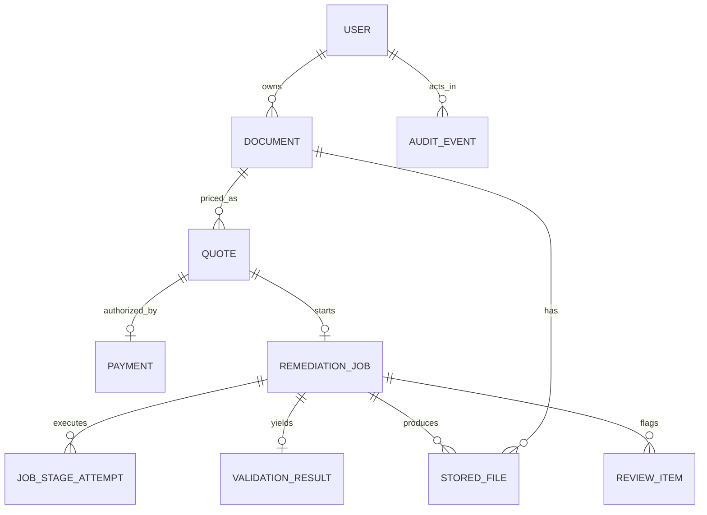
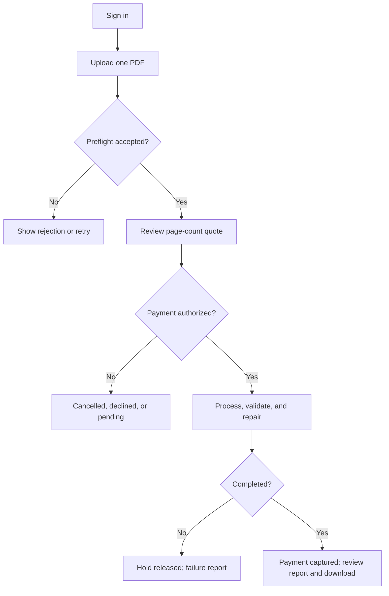

# PDF Remediation Service — Product Requirements Document

**Document status:** Draft for stakeholder review, revised 2026-11-26 to match `GLOSSARY.md` and `docs/adr/`  
**Target platform:** .NET  
**Delivery team:** One developer  
**Target schedule:** A fixed two-week writer spike (T-005), then a schedule re-estimated from its results  
**Primary audience:** Government staff who publish or maintain PDF documents

## 1. Summary

PDF Remediation Service is a paid web application for government staff who need to improve the accessibility of PDF documents without changing their visible appearance. A customer uploads one PDF, sees a price calculated from its page count, and authorizes payment. The customer is charged only if remediation completes, and then receives a remediated PDF plus a machine-readable and human-readable processing report. If remediation fails, the hold is released and the customer receives a failure report instead. The MVP uses one document-understanding reader (Mistral OCR 4.1 or a self-hosted PaddleOCR-VL-1.6, chosen by benchmark) plus Claude Haiku 5.5 for heading levels, list structure and alt-text drafts; a vendor-neutral accessibility intermediate representation (IR); the service's own tag writer, which adds a new tag tree to a copy of the original PDF without changing its page content (ADR 0003); and veraPDF to validate machine-verifiable PDF/UA requirements. Documents are processed by third-party services, so the MVP accepts only Documents the customer attests are intended for public release (ADR 0004). The service reports validation and confidence results but does not promise that automated output is fully ADA, WCAG, or PDF/UA conformant without human review.

## 2. Problem Statement

Government organizations publish born-digital, scanned, and mixed PDFs. Many files lack a usable tag tree, correct reading order, table semantics, list structure, alternative text, language metadata, or searchable text. Manual remediation requires specialized knowledge and does not scale well for routine document volumes.

Existing automated products demonstrate that PDFs can be auto-tagged, but the source research states that auto-tagging is not the same as accessibility compliance. Machine validators can confirm technical rules while still missing incorrect headings, weak alternative text, illogical reading order, or inaccurate table relationships. Doing nothing leaves inaccessible content in publication workflows, increases manual remediation effort, and leaves government customers without a repeatable way to measure or improve PDF accessibility.

The commercial opportunity is a per-page service. The research in `docs/research/` estimates variable processing cost at about $0.0066 per page with hosted services (Mistral OCR 4.1 plus Claude Haiku 5.5), or about $0.002 per page with a self-hosted reader. The tag writer, veraPDF, OCRmyPDF and PDFium carry no licence fee. The target is a gross margin of 90% or better. Card fees include a fixed amount per transaction, so small orders will need a minimum charge or another payment model (OQ-02).

## 3. Goals / Non-Goals

### Goals

- Accept one customer PDF per order.
- Determine and display the page count before payment.
- Calculate the order amount as `page count × configured price per page`.
- Place a payment Authorization before starting paid remediation, Capture it only when the Job is Completed, and Release it otherwise (ADR 0002).
- Preserve the original visible page content.
- Support born-digital, scanned, and mixed PDFs through a page-aware processing pipeline.
- Use one document-understanding reader (Mistral OCR 4.1 or PaddleOCR-VL-1.6, chosen by the T-005 benchmark) to identify text blocks, structural labels, geometry, confidence, and reading order, and Claude Haiku 5.5 to assign heading levels and list structure and to draft alt text.
- Normalize model output into a vendor-neutral accessibility IR owned by the product.
- Use the service's own tag writer to add a new tag tree to a copy of the original PDF without changing its page content (ADR 0003).
- Accept only Documents that carry a Public-release attestation (ADR 0004).
- Validate the output with veraPDF.
- Deliver the remediated PDF only when it passes both Visual preservation and veraPDF validation, with a report that distinguishes technical validation, visual preservation, per-Element confidence, and manual-review recommendations.
- Record enough stage-level data to diagnose failures without logging customer document content.

### Non-Goals

- The MVP will not guarantee that every output is ADA compliant, WCAG 2.1 AA conformant, or PDF/UA conformant.
- The MVP will not replace human accessibility review for low-confidence or complex content.
- The MVP will not include an in-browser PDF tag-tree editor or manual remediation workstation.
- The MVP will not process multiple uploaded PDFs in one order.
- The MVP will not expose a public bulk-processing API.
- The MVP will not decide in advance between a hosted and a self-hosted reader; the T-005 benchmark chooses between Mistral OCR 4.1 and a self-hosted PaddleOCR-VL-1.6 on quality, speed and cost per page. GLM-OCR, DeepSeek-OCR, Docling and MinerU are not MVP readers.
- The MVP will not use Adobe Auto-Tag as its production remediation engine.
- The MVP will not buy a commercial tagging SDK (PDFix, Apryse, Aspose) unless the ADR 0003 trigger is met.
- The MVP will not process Documents that are not intended for public release; a private pipeline is phase 2 (ADR 0004).
- The MVP will not offer subscriptions, prepaid page credits, or a minimum charge; pricing models are decided after the pipeline works (OQ-02).
- The MVP will not embed PAC 2026 in the hosted service.
- The MVP will not include a human-verified paid tier.
- The MVP will not recreate a PDF from Markdown, HTML, or model-generated page content.

## 4. Success Criteria

| ID | Criterion | Measurement |
|---|---|---|
| SC-01 | A customer can complete the primary path. | Upload, quote, payment, processing, report, and download succeed in an end-to-end test. |
| SC-02 | Pricing is deterministic. | For every accepted test file, displayed subtotal equals persisted page count multiplied by the active per-page price in cents. |
| SC-03 | Unauthorized jobs do not consume paid remediation services. | No reader, Haiku, or tag-writer stage begins until the payment record is in `Authorized` state. |
| SC-04 | Visible content is preserved. | Input and output pages rendered by the same renderer at the same resolution produce a pixel mismatch ratio of `0.0000`; any non-zero result is reported and prevents a `Completed` status. |
| SC-05 | Technical validation is reported honestly. | Every job that reaches validation records the veraPDF profile, pass/fail result, rule-failure count, Repair passes used, and raw report file; no job with remaining Validation failures becomes `Completed`. |
| SC-06 | Low-confidence work is visible. | Every block below the configured confidence threshold creates a review item with page number, type, and confidence. |
| SC-07 | Variable processing cost is observable. | Each completed reader and Haiku stage records pages or tokens submitted and estimated cost using the configured provider rates; a self-hosted reader records GPU seconds and an estimated cost per page. |
| SC-08 | Failure handling is testable. | Automated tests cover invalid, encrypted, and signed PDFs, authorization failure, reader timeout, Haiku timeout, tag-writer failure, veraPDF failure after Repair passes, authorization-expiry release, cancellation, and unavailable download. |
| SC-11 | Customers are never charged for undelivered output. | Every `Failed` or `Cancelled` job ends with its Authorization `Released` and no Capture. |
| SC-09 | The customer interface is accessible. | MVP screens pass automated WCAG 2.1 AA checks and a documented keyboard-only test of the primary path. |
| SC-10 | The first release is supportable. | A new operator can use the runbook to identify a failed stage, retry an eligible job, or issue the documented manual fallback within 15 minutes. `[ASSUMPTION]` |

## 5. Users & Roles

| Role | Capabilities | Permission boundaries |
|---|---|---|
| Customer | One person's account. Create an account, upload one PDF, view its quote, authorize payment, cancel a still-queued job, view job status, download owned files, and delete owned files before automatic expiration. `[ASSUMPTION]` | Can access only records and files linked to their own user ID. Cannot change prices, retry internal stages, see provider payloads, or access another customer's order. |
| Service Operator | View all jobs, stage status, non-content error summaries, validation results, and audit events; retry eligible failed jobs; issue the rare post-Capture Refund manually in the payment provider. `[ASSUMPTION]` | Cannot view payment credentials. Document download access is disabled by default and requires a separately logged support action. `[ASSUMPTION]` |
| Service Administrator | All operator capabilities plus configure price per page, confidence threshold, file limits, retention period, and integration enablement. `[ASSUMPTION]` | Cannot alter the amount or page count of an already-created quote. Cannot mark a payment as authorized or captured without a verified provider event. |
| Background Worker | Read Authorized queued jobs, access source files, call processing integrations, write derived files, and update stage status. `[ASSUMPTION]` | Has no interactive login and no ability to change pricing or user data. |

## 6. Scope

| Area | MVP | Phase 2 | Explicitly Out of Scope |
|---|---|---|---|
| Customer workflow | Individual account, single PDF upload, page-count quote, payment authorization, cancel while queued, status, report, download | Saved payment methods, order history filters, organization accounts | Anonymous public processing `[ASSUMPTION]` |
| Pricing | One configurable per-page price; one currency `[ASSUMPTION]` | Volume tiers, contracts, coupons, tax calculation, minimum charges, subscriptions, prepaid page credits | Negotiated enterprise billing in the MVP |
| Document input | Born-digital, scanned, and mixed PDFs; one file per order; fillable forms accepted but fields left unremediated | Batch ZIP, portfolio PDFs, public API, form-field remediation | Non-PDF input; password-protected, permission-restricted, or digitally signed PDFs |
| Understanding | One reader chosen by the T-005 benchmark (Mistral OCR 4.1 or self-hosted PaddleOCR-VL-1.6) for blocks, labels, confidence, and reading order, plus Claude Haiku 5.5 for heading levels, lists, and alt text | The other reader as a second adapter; ensemble routing | LayoutParser-based primary pipeline; GLM-OCR (too few structural labels for tagging) |
| Remediation | The service's own tag writer (built on PdfPig) applied to a copy of the original PDF (ADR 0003); OCRmyPDF adds the invisible text layer on image-only pages | Wider writer coverage (Form XObject content, optional content, form fields); Aspose.PDF if the ADR 0003 trigger is met | Rebuilding pages from HTML or Markdown |
| Validation | veraPDF, custom confidence rules, pixel comparison | Adobe checker, PAC-assisted QA, semantic second-pass model, NVDA/JAWS test service | Claiming machine validation replaces human review |
| Accessibility structures | Headings, paragraphs, lists, tables, figures with model-drafted alt text, artifacts, reading order, document title/language when the IR provides them; existing tag trees are replaced (ADR 0001) | Interactive corrections, advanced formula/MathML review, table repair UI | Human-authored remediation in the MVP |
| Service tiers | Automated remediation | Complex-document pricing, verified human review, bulk/API, government annual plans | Human review bundled into every MVP order |
| Operations | Single deployment as Docker Compose, which also runs on the developer's desktop with a GPU `[ASSUMPTION]` | Autoscaling and multi-region operation | — |
| Data handling | Documents with a Public-release attestation, processed by third-party services (ADR 0004) | Private pipeline using a self-hosted reader and alt-text model | Documents that may not be shared with third-party processors |

## 7. User Stories & Acceptance Criteria

### 7.1 Account and Access

#### US-01 — Create and use a customer account

*As a customer, I want to sign in to a private account, so that only I can access my documents, orders, and downloads.*

**Depends on:** FR-01, FR-02, FR-21

**Acceptance criteria**

1. **Given** a visitor is not authenticated, **when** the visitor opens an upload or job URL, **then** the application redirects to sign-in and preserves only a safe local return path.
2. **Given** a customer is authenticated, **when** the customer opens the dashboard, **then** only that customer's jobs are listed.
3. **Given** Customer A knows Customer B's job identifier, **when** Customer A requests Customer B's status, report, or download URL, **then** the application returns `404` and records an authorization-denied audit event without revealing that the job exists.
4. **Given** a sign-in attempt fails, **when** the page returns, **then** no document data is shown and the page displays a generic authentication error.

### 7.2 Upload and Preflight

#### US-02 — Upload a PDF

*As a customer, I want to upload one PDF, so that the service can inspect it and calculate a price.*

**Depends on:** FR-03, FR-04, FR-05, FR-20, FR-47

**Acceptance criteria**

1. **Given** an authenticated customer selects a valid PDF within configured limits, **when** upload completes, **then** the application creates a document record, stores the original file, and starts preflight.
2. **Given** a file extension is not `.pdf`, **when** upload is attempted, **then** the application rejects it before storage and explains that only PDF files are accepted.
3. **Given** a file is named `.pdf` but does not begin with a valid PDF signature or cannot be parsed, **when** preflight runs, **then** the document is marked `Rejected`, no quote is created, and the customer sees a non-technical error.
4. **Given** a PDF exceeds either the configured byte or page limit, **when** preflight runs, **then** the document is marked `Rejected`, no paid processing begins, and the actual and allowed limits are shown.
5. **Given** preflight cannot read page count, **when** the parser fails, **then** the customer sees a retry option and no amount is charged.
6. **Given** a PDF is password-protected, permission-restricted, or digitally signed, **when** preflight runs, **then** the document is marked `Rejected`, no quote is created, and the customer is told why (for a signed PDF: remediation would invalidate the signature).
7. **Given** preflight runs, **when** it finishes, **then** it has performed no rendering, OCR, or other processing beyond what is needed to validate the file and count its pages.
8. **Given** a customer uploads a PDF, **when** they have not confirmed the Public-release attestation, **then** the upload is refused; **when** they confirm it, **then** the attestation time is stored on the Document (ADR 0004).

#### US-03 — Review a page-count quote

*As a customer, I want to see the page count and price before paying, so that I can decide whether to continue.*

**Depends on:** FR-06, FR-07, FR-08

**Acceptance criteria**

1. **Given** preflight succeeds, **when** the quote page loads, **then** it shows filename, page count, unit price, currency, subtotal, quote expiration, and a statement that automated remediation does not guarantee compliance.
2. **Given** the configured price is `P` cents and the file contains `N` pages, **when** a quote is created, **then** its amount is exactly `P × N` cents using integer arithmetic.
3. **Given** an administrator changes the price after a quote is created, **when** the customer views the existing unexpired quote, **then** its stored unit price and total do not change.
4. **Given** a quote has expired, **when** the customer attempts checkout, **then** checkout is blocked and the customer must create a new quote using the current price.
5. **Given** pricing is not configured or payment processing is disabled, **when** preflight completes, **then** no payable quote is produced and the customer sees that ordering is temporarily unavailable.

### 7.3 Payment

#### US-04 — Authorize payment for an order

*As a customer, I want to commit to the quoted amount and be charged only if I receive a remediated PDF, so that remediation can start without risk of paying for nothing.*

**Depends on:** FR-09, FR-10, FR-11, FR-12, FR-40

**Acceptance criteria**

1. **Given** an unexpired open quote, **when** the customer selects pay, **then** the application creates one payment-provider checkout for the exact stored amount and currency, using manual capture and offering only payment methods that support holds.
2. **Given** the payment provider sends a valid signed authorization event, **when** the event is processed, **then** the payment becomes `Authorized`, its authorization expiry is recorded, and exactly one remediation job is queued.
3. **Given** the customer returns from checkout before the provider event arrives, **when** the status page loads, **then** it displays `Confirming payment` and does not start remediation.
4. **Given** payment is cancelled or declined, **when** the customer returns, **then** the quote remains open, no remediation job starts, and the customer can retry payment while the quote is valid.
5. **Given** the same valid provider event is delivered more than once, **when** later copies are processed, **then** no duplicate payment record, capture, or remediation job is created.
6. **Given** a provider event has an invalid signature or mismatched amount/currency, **when** it is received, **then** the event is rejected, no job is queued, and an operator alert is recorded.
7. **Given** a job becomes `Completed`, **when** completion commits, **then** the Authorization is Captured exactly once.
8. **Given** a job becomes `Failed` or `Cancelled`, **when** the terminal state commits, **then** the Authorization is Released and nothing is captured.

### 7.4 Remediation Processing

#### US-05 — Process an authorized PDF

*As a customer, I want my PDF processed once payment is authorized without changing its visible pages, so that I receive a more accessible version of the same document.*

**Depends on:** FR-13, FR-14, FR-15, FR-16, FR-17, FR-18, FR-19, FR-41, FR-42, FR-43, FR-44, FR-48, FR-49

**Acceptance criteria**

1. **Given** a payment is `Authorized` and no job exists for the quote, **when** the queue action commits, **then** one job enters `Queued` state.
2. **Given** a queued job, **when** a worker claims it, **then** only that worker can execute the current attempt and the job moves to `Preprocessing`.
3. **Given** native text and graphic Source objects, **when** preprocessing completes, **then** the system retains their references and produces page renders for model analysis.
4. **Given** image-only Source objects (such as a scanned page), **when** preprocessing completes, **then** OCRmyPDF adds an invisible text layer to those pages without changing how they render, and the regions are prepared for tag generation.
5. **Given** preprocessing completes, **when** the job record is updated, **then** it stores one descriptive Document classification (`born-digital`, `scanned`, or `mixed`) derived from the Source objects; the classification does not change price or processing route.
6. **Given** preprocessing succeeds, **when** the reader runs, **then** block geometry, text, reading order, labels, and available confidence values are normalized into the IR, and Claude Haiku 5.5 adds heading levels, list structure, and alt-text drafts.
7. **Given** the IR is valid, **when** the tag writer runs, **then** it adds accessibility structures to a copy of the original PDF by wrapping existing content in marked-content sequences, and does not regenerate or rewrite visible page content.
8. **Given** a provider or worker timeout occurs, **when** the attempt ends, **then** the stage is recorded as transiently failed and retried according to INT-01 or INT-02 without creating another charge.
9. **Given** the IR cannot be mapped to source objects or the tag writer reports unsupported content or an unrecoverable file error, **when** remediation stops, **then** the job becomes `Failed`, the original file remains unchanged, the Authorization is Released, and the customer receives a Failure report.
10. **Given** the input already has a structure tree, **when** the tag writer runs, **then** the existing tree is replaced from the IR and the report records that the original was tagged (ADR 0001).
11. **Given** an informative Figure, **when** the IR is built, **then** alt text is drafted by the model and a Review item of type `AltText` is created for it.
12. **Given** a page has fillable form fields, **when** remediation runs, **then** the fields are left unchanged and a Review item of type `FormField` is created for that page.
13. **Given** a job is not `Completed` 24 hours before its Authorization expires, **when** the expiry check runs, **then** the job becomes `Failed` with category `processing_timeout`, and the Authorization is Released. `[ASSUMPTION]`

#### US-12 — Cancel a queued job

*As a customer, I want to cancel a job that has not started processing, so that I am not charged if I change my mind.*

**Depends on:** FR-45

**Acceptance criteria**

1. **Given** a job is `Queued`, **when** the customer cancels it, **then** the job becomes `Cancelled`, the Authorization is Released, and no paid stage runs.
2. **Given** a job has entered `Preprocessing` or a later state, **when** the customer views it, **then** no cancel action is offered and a direct cancel request is rejected without changing the job.
3. **Given** a worker claims the job and the customer cancels at the same moment, **when** both commit, **then** exactly one wins: the job is either `Cancelled` with no stage started, or processing continues and cancellation is rejected.

#### US-06 — Track job status

*As a customer, I want to see the current processing stage, so that I know whether to wait, download, or seek support.*

**Depends on:** FR-22, FR-23

**Acceptance criteria**

1. **Given** a job is active, **when** its status page is open, **then** it displays one of: `Queued`, `Analyzing`, `Remediating`, `Validating`, or `Preparing results`.
2. **Given** a stage changes, **when** the client refreshes or polls within 15 seconds, **then** the displayed status matches the persisted customer-facing status. `[ASSUMPTION]`
3. **Given** no jobs exist, **when** the customer opens the dashboard, **then** an empty state links to upload.
4. **Given** status retrieval fails, **when** the page cannot load current data, **then** the last known state is not presented as current and a retry control is shown.
5. **Given** a job fails, **when** the status page loads, **then** it displays the Failure report (customer-safe failure categories with page numbers), confirmation that the payment hold was Released, and a support reference ID, without exposing stack traces or provider secrets.

### 7.5 Validation and Results

#### US-07 — Receive validation results

*As a customer, I want to understand what automation verified and what still needs review, so that I do not mistake an automated result for a compliance guarantee.*

A job is `Completed` only when its output passes both Visual preservation and veraPDF validation. A Completed job carries a Result verdict of `Manual review recommended` or `Automated checks passed`.

**Depends on:** FR-24, FR-25, FR-26, FR-27, FR-39, FR-46

**Acceptance criteria**

1. **Given** the tag writer produces an output PDF, **when** veraPDF validation completes, **then** the system records the validation profile, pass/fail status, and every reported rule failure.
2. **Given** input and output renders are compared, **when** any pixel differs, **then** Visual preservation fails, the job becomes `Failed`, the Authorization is Released, and no output is offered.
3. **Given** veraPDF reports Validation failures, **when** Repair passes remain (maximum 3), **then** the next Repair pass runs, escalating from targeted fix-ups to structural fallbacks to re-analysis of affected pages, and is recorded as an Attempt. `[ASSUMPTION]`
4. **Given** a Repair pass applies a structural fallback (for example a table simplified to paragraphs), **when** the report is built, **then** a Review item of type `StructuralFallback` records what was simplified and where.
5. **Given** Validation failures remain after the last Repair pass, **when** the job closes, **then** it becomes `Failed`, the Authorization is Released, and the customer receives a Failure report listing the categories and pages that could not be fixed. No PDF is offered.
6. **Given** any IR Element is below the job's confidence threshold, **when** the report is built, **then** it lists a Review item with page number, element type, confidence, and reason. No document-level confidence score is produced.
7. **Given** a job is `Completed` and Review items exist, **when** the report is shown, **then** the Result verdict is `Manual review recommended`, never `Compliant`.
8. **Given** a job is `Completed` with no Review items, **when** the report is shown, **then** the Result verdict is `Automated checks passed` and the report still states that automated checks do not guarantee ADA, WCAG, or PDF/UA compliance.

#### US-08 — Download result files

*As a customer, I want to download the remediated PDF and report, so that I can review and publish the result.*

**Depends on:** FR-28, FR-29, FR-30

**Acceptance criteria**

1. **Given** a job is `Completed`, **when** the customer selects download PDF, **then** the application authorizes ownership and returns the remediated PDF with a safe filename and `application/pdf` content type.
2. **Given** a report exists, **when** the customer selects download report, **then** the application returns JSON containing the job summary, Result verdict or failure categories, validation summary, visual-diff result, and Review items.
3. **Given** the file retention date has passed, **when** the customer requests a download, **then** the application returns `410 Gone`, explains that the file expired, and does not expose the storage path.
4. **Given** an stored file record exists but its file is missing, **when** download is requested, **then** the application returns a customer-safe error, records an operational error, and does not mark the job as newly failed.
5. **Given** an incomplete or failed job, **when** the customer requests a remediated PDF URL directly, **then** the application returns `404`.

### 7.6 Failure Recovery and Operations

#### US-09 — Retry a transient processing failure

*As a service operator, I want to retry an eligible failed stage without charging the customer again, so that transient vendor or infrastructure failures can recover.*

**Depends on:** FR-31, FR-32, FR-33

**Acceptance criteria**

1. **Given** a job failed with a retryable category and has attempts remaining, **when** an operator selects retry, **then** a new stage attempt is queued against the same job and order.
2. **Given** a job failed due to invalid input, an IR validation error, a visual-diff failure, or Validation failures remaining after the last Repair pass, **when** the operator opens the job, **then** retry is disabled unless the underlying implementation or configuration changed and the operator records a reason. `[ASSUMPTION]`
3. **Given** the retry action is submitted twice, **when** both requests are handled, **then** at most one active retry attempt is created.
4. **Given** all retry attempts fail, **when** the last attempt closes, **then** the job remains `Failed`, the Authorization is Released, and the customer sees the Failure report.
5. **Given** an operator retry would finish after the Authorization's safety margin, **when** the operator opens the job, **then** retry is disabled and the job is Failed and Released instead. `[ASSUMPTION]`

#### US-10 — Configure commercial and processing settings

*As a service administrator, I want to configure pricing and processing limits, so that orders use an explicit approved policy.*

**Depends on:** FR-34, FR-35, FR-36

**Acceptance criteria**

1. **Given** an administrator enters a positive integer price in cents, **when** it is saved, **then** new quotes use it and existing quotes are unchanged.
2. **Given** an administrator enters zero, a negative number, or a fractional cent, **when** save is attempted, **then** validation fails.
3. **Given** an administrator changes a confidence threshold, **when** a new job begins, **then** that job stores and uses the new value while existing jobs retain their stored value.
4. **Given** a non-administrator requests the settings page or endpoint, **when** authorization runs, **then** access is denied and an audit event is recorded.
5. **Given** any production-critical integration is disabled or lacks configuration, **when** an administrator views health status, **then** the integration is identified as unavailable without displaying its secret value.

#### US-11 — Audit an order and job

*As a service operator, I want a timestamped event history, so that I can explain what happened without reading the customer's document content.*

**Depends on:** FR-37, FR-38

**Acceptance criteria**

1. **Given** an upload, quote, payment event, stage transition, retry, download, configuration change, or deletion occurs, **when** it commits, **then** an audit event records actor, action, target identifier, UTC timestamp, and correlation ID.
2. **Given** a provider returns document text or image data, **when** application logs are written, **then** that content is not present in structured logs.
3. **Given** an operator searches by support reference or job ID, **when** a match exists, **then** the event timeline is displayed in timestamp order.
4. **Given** no match exists, **when** search completes, **then** an empty result is shown without an application error.

## 8. Functional Requirements

| ID | Requirement | Related stories |
|---|---|---|
| FR-01 | The system shall authenticate each interactive customer before allowing upload, order, status, report, or download access. `[ASSUMPTION]` | US-01 |
| FR-02 | The system shall authorize every customer data request by the authenticated user's ID and return `404` for another customer's resource. `[ASSUMPTION]` | US-01 |
| FR-03 | The system shall accept exactly one file per upload operation. | US-02 |
| FR-04 | The system shall accept only files whose extension, media type, signature, and parser result identify a PDF. `[ASSUMPTION]` | US-02 |
| FR-05 | The system shall persist the original PDF unchanged and record its SHA-256 hash before preflight. `[ASSUMPTION]` | US-02 |
| FR-06 | The system shall determine page count before creating a payable quote. | US-03 |
| FR-07 | The system shall calculate quote total in integer minor currency units as `page count × unit price`. | US-03 |
| FR-08 | The system shall store the quote's page count, unit price, currency, total, creation time, and expiration time so later price changes do not alter it. `[ASSUMPTION]` | US-03 |
| FR-09 | The system shall create payment checkout only for an unexpired unpaid quote. | US-04 |
| FR-10 | The system shall treat a signed payment-provider event, not the browser return, as confirmation of Authorization. `[ASSUMPTION]` | US-04 |
| FR-11 | The system shall reject payment events with invalid signature, unknown provider ID, duplicate event ID, or mismatched amount/currency. `[ASSUMPTION]` | US-04 |
| FR-12 | The system shall create at most one remediation job per Authorized quote. | US-04 |
| FR-13 | The system shall start reader, Haiku, or tag-writer processing only after the related payment status is `Authorized`. | US-05 |
| FR-14 | The system shall decide OCR per Source object (native text kept, image-only regions OCR'd) and record one descriptive Document classification (`born-digital`, `scanned`, or `mixed`) during preprocessing. `[ASSUMPTION]` | US-05 |
| FR-15 | The system shall render each input page at one configured resolution using one pinned renderer version for later model input and visual comparison. `[ASSUMPTION]` | US-05 |
| FR-16 | The system shall submit page content to the configured reader (Mistral OCR 4.1 or PaddleOCR-VL-1.6) and request block-level output that includes available text, labels, bounding boxes, reading order, and confidence. | US-05 |
| FR-17 | The system shall normalize reader and Haiku output into the Accessibility IR and shall validate the IR against a versioned schema before the tag writer runs. | US-05 |
| FR-18 | The system shall preserve native text/object references for born-digital content and shall use OCR-derived accessible text only for image-only regions. | US-05 |
| FR-19 | The system shall use its own tag writer to add a new tag tree to a copy of the original PDF, inserting marked-content operators around existing content and saving incrementally, rather than recreating visible pages (ADR 0003). | US-05 |
| FR-20 | The system shall reject files outside configured byte or page limits, and password-protected, permission-restricted, or digitally signed files, before payment, without rendering or OCR. `[ASSUMPTION]` | US-02 |
| FR-21 | The system shall isolate customer data by user and use non-sequential public identifiers. `[ASSUMPTION]` | US-01 |
| FR-22 | The system shall map internal stages to customer-facing states: `Queued`, `Analyzing`, `Remediating`, `Validating`, `Preparing results`, `Completed`, `Failed`, or `Cancelled`. `[ASSUMPTION]` | US-06 |
| FR-23 | The system shall make persisted job status available to the owner without exposing provider payloads or stack traces. | US-06 |
| FR-24 | The system shall run veraPDF against every tag-writer output before completion. | US-07 |
| FR-25 | The system shall render and compare every input and output page with identical settings and record pixel mismatch count and ratio. | US-07 |
| FR-26 | The system shall create Review items for IR Elements below the job's stored confidence threshold, drafted alt text, structural fallbacks, and pages with form fields. Validation failures are reported separately, not as Review items. | US-07 |
| FR-27 | The system shall never label an automated output `ADA compliant`, `WCAG compliant`, or `PDF/UA compliant` solely because automated checks pass. | US-07 |
| FR-28 | The system shall provide the owner a downloadable remediated PDF only for a `Completed` job, meaning it passed both veraPDF validation and Visual preservation. | US-08 |
| FR-29 | The system shall provide the owner a downloadable JSON processing report. | US-08 |
| FR-30 | The system shall stop downloads after the file expiration timestamp and shall delete expired file bytes through a scheduled cleanup process. `[ASSUMPTION]` | US-08 |
| FR-31 | The system shall classify failures as retryable or non-retryable. `[ASSUMPTION]` | US-09 |
| FR-32 | The system shall prevent more than one active processing attempt for the same stage and job. `[ASSUMPTION]` | US-09 |
| FR-33 | The system shall allow an operator to retry eligible failures without creating a new order or charge. `[ASSUMPTION]` | US-09 |
| FR-34 | The system shall allow an administrator to configure a positive whole-cent price per page and one ISO 4217 currency. `[ASSUMPTION]` | US-10 |
| FR-35 | The system shall snapshot active processing settings onto a job when the job is queued. `[ASSUMPTION]` | US-10 |
| FR-36 | The system shall expose health state for the database, file storage, payment adapter, reader adapter, Haiku adapter, OCRmyPDF executable, and veraPDF executable without exposing secrets. `[ASSUMPTION]` | US-10 |
| FR-37 | The system shall create append-only audit events for security, commercial, processing, download, retry, configuration, and deletion actions. `[ASSUMPTION]` | US-11 |
| FR-38 | The system shall assign one correlation ID to each request and carry the job correlation ID through background stages and integration calls. `[ASSUMPTION]` | US-11 |
| FR-39 | The system shall run up to 3 Repair passes when veraPDF reports Validation failures, escalating from targeted fix-ups to structural fallbacks to re-analysis, and fail the job if failures remain. `[ASSUMPTION]` | US-07 |
| FR-40 | The system shall Capture the Authorization only when a job becomes `Completed`, and Release it when a job becomes `Failed` or `Cancelled`. | US-04 |
| FR-41 | The system shall Release the Authorization and fail any job not `Completed` 24 hours before the Authorization expires. `[ASSUMPTION]` | US-05 |
| FR-42 | The system shall replace any existing structure tree in the input with one built from the IR, and record in the report that the input was previously tagged. | US-05 |
| FR-43 | The system shall draft alt text for informative Figures with the document-understanding model and never mark a Figure decorative to avoid a validation failure. | US-05 |
| FR-44 | The system shall accept PDFs with fillable form fields, leave the fields unchanged, and raise a Review item for each page that has them. | US-05 |
| FR-45 | The system shall let the owner cancel a job only while it is `Queued`. | US-12 |
| FR-46 | The system shall produce a customer-safe Failure report, with failure categories and page numbers, for every `Failed` job. | US-06, US-07 |
| FR-47 | The system shall refuse an upload until the customer confirms the Public-release attestation, and shall store its time on the Document. | US-02 |
| FR-48 | The system shall send each page image and the reader's blocks to Claude Haiku 5.5 and accept only schema-valid JSON for heading levels, list structure, table header hints, and alt-text drafts. | US-05 |
| FR-49 | The system shall add an invisible OCR text layer with OCRmyPDF only to pages without native text, and the visual diff shall still report `0.0000` for those pages. | US-05 |

## 9. Data Model

### 9.1 Data requirements

| ID | Requirement |
|---|---|
| DR-01 | All primary keys shall be UUIDs generated by the application or database. `[ASSUMPTION]` |
| DR-02 | All timestamps shall be stored as UTC with timezone-aware database types. `[ASSUMPTION]` |
| DR-03 | Monetary amounts shall be stored as integer minor units; floating-point types are prohibited. `[ASSUMPTION]` |
| DR-04 | Original PDF, rendered pages, Accessibility IR, remediated PDF, raw validator output, and customer report shall be stored as Stored files outside relational row data. `[ASSUMPTION]` |
| DR-05 | Stored file rows shall store SHA-256, byte length, media type, storage key, creation time, and expiration time. `[ASSUMPTION]` |
| DR-06 | The Accessibility IR shall include a schema version and stable element IDs. |
| DR-07 | Each IR element shall support page, semantic type, bounding box, reading order, text when applicable, confidence when available, source-object references when available, parent ID, and semantic properties. |
| DR-08 | Table IR shall support rows, columns, `TH`/`TD`, header scope, row span, and column span. |
| DR-09 | List IR shall support `L`, `LI`, `Lbl`, and `LBody` relationships. |
| DR-10 | Figure IR shall support decorative status and alternative text when generated or supplied. |
| DR-11 | Payment-provider secrets and full payment instrument data shall never be stored in the application database. `[ASSUMPTION]` |
| DR-12 | Audit events shall be append-only to application roles; corrections shall be new events. `[ASSUMPTION]` |
| DR-13 | Jobs, quotes, and payments shall retain the exact configuration values used for their execution. `[ASSUMPTION]` |
| DR-14 | Deleting a Document shall delete all its Stored files and its original filename immediately, while Quote, Payment, Refund, and audit records are retained without document content. |
| DR-15 | "Order" is customer-facing language for an Authorized Quote; there is no separate Order entity. |

### 9.2 Entities and fields

#### `User`

| Field | Type | Null | Rules |
|---|---|---:|---|
| `Id` | UUID | No | Primary key. |
| `Email` | string(320) | No | Normalized unique index. `[ASSUMPTION]` |
| `Role` | enum | No | `Customer`, `Operator`, or `Administrator`. |
| `CreatedAtUtc` | timestamp | No | Set once. |
| `DisabledAtUtc` | timestamp | Yes | Disabled users cannot authenticate. |

#### `Document`

| Field | Type | Null | Rules |
|---|---|---:|---|
| `Id` | UUID | No | Primary key and public non-sequential ID. |
| `OwnerUserId` | UUID | No | Foreign key to `User`. |
| `OriginalFileId` | UUID | Yes | Required after upload succeeds. |
| `OriginalFileName` | string(255) | Yes | Strip path components and control characters. Cleared on deletion. `[ASSUMPTION]` |
| `Sha256` | char(64) | Yes | Lowercase hexadecimal after storage. |
| `ByteLength` | long | Yes | Positive. |
| `PageCount` | int | Yes | Positive after preflight. |
| `PreflightStatus` | enum | No | `Uploaded`, `Inspecting`, `Accepted`, `Rejected`, `Failed`. |
| `RejectionCode` | string(50) | Yes | Required when status is `Rejected`; includes `encrypted`, `restricted`, and `signed`. |
| `PublicReleaseAttestedAtUtc` | timestamp | Yes | Required before Preflight starts (ADR 0004). |
| `CreatedAtUtc` | timestamp | No | Set once. |
| `ExpiresAtUtc` | timestamp | No | Derived from active retention setting. `[ASSUMPTION]` |

#### `Quote`

| Field | Type | Null | Rules |
|---|---|---:|---|
| `Id` | UUID | No | Primary key. |
| `DocumentId` | UUID | No | Foreign key to accepted `Document`. |
| `PageCount` | int | No | Snapshot; must equal accepted count at creation. |
| `UnitPriceMinor` | int | No | Positive whole number. |
| `Currency` | char(3) | No | ISO 4217 uppercase. `[ASSUMPTION]` |
| `TotalMinor` | long | No | Must equal page count × unit price. |
| `Status` | enum | No | `Open`, `CheckoutPending`, `Ordered`, `Expired`, `Cancelled`. `Ordered` means an Authorization exists. |
| `CreatedAtUtc` | timestamp | No | Set once. |
| `ExpiresAtUtc` | timestamp | No | Later than creation. |

#### `Payment`

| Field | Type | Null | Rules |
|---|---|---:|---|
| `Id` | UUID | No | Primary key. |
| `QuoteId` | UUID | No | Unique foreign key to `Quote`. `[ASSUMPTION]` |
| `Provider` | string(50) | No | Provider identifier; final value pending OQ-03. |
| `ProviderCheckoutId` | string(255) | Yes | Unique when present. |
| `ProviderPaymentId` | string(255) | Yes | Unique when present. |
| `AmountMinor` | long | No | Must equal quote total. |
| `Currency` | char(3) | No | Must equal quote currency. |
| `Status` | enum | No | `Pending`, `Authorized`, `Captured`, `Released`, `Failed`, `Refunded`. |
| `AuthorizedAtUtc` | timestamp | Yes | Required from `Authorized` onward. |
| `AuthorizationExpiresAtUtc` | timestamp | Yes | From the provider; drives the release deadline (FR-41). |
| `CapturedAtUtc` | timestamp | Yes | Required for `Captured` and `Refunded`. |
| `ReleasedAtUtc` | timestamp | Yes | Required for `Released`. |
| `LastProviderEventId` | string(255) | Yes | Used with provider-event table or unique constraint for idempotency. `[ASSUMPTION]` |

#### `RemediationJob`

| Field | Type | Null | Rules |
|---|---|---:|---|
| `Id` | UUID | No | Primary key and support reference. |
| `QuoteId` | UUID | No | Unique foreign key; one job per Authorized quote. |
| `PaymentId` | UUID | No | Unique foreign key to the Authorized payment. |
| `OwnerUserId` | UUID | No | Denormalized authorization key. `[ASSUMPTION]` |
| `DocumentId` | UUID | No | Foreign key. |
| `Status` | enum | No | Internal state machine defined below. |
| `CurrentStage` | enum | Yes | `Render`, `Ocr`, `NormalizeIr`, `Remediate`, `Validate`, `Repair`, `VisualDiff`, `Report`. Preflight is a Document concern, not a job stage. |
| `DocumentClassification` | enum | Yes | `BornDigital`, `Scanned`, `Mixed`; set during preprocessing; descriptive only. |
| `InputWasTagged` | bool | Yes | Set during preprocessing; reported per ADR 0001. |
| `RepairPassesUsed` | int | No | `0–3`. `[ASSUMPTION]` |
| `IrSchemaVersion` | string(20) | No | Example: `1.0`. `[ASSUMPTION]` |
| `ConfidenceThreshold` | decimal(5,4) | No | Range `0.0000–1.0000`; snapshot. |
| `RenderDpi` | int | No | Snapshot; default pending OQ-10. |
| `ReaderProvider` | enum | No | `MistralOcr41` or `PaddleOcrVl16`; snapshot. |
| `ReaderRatePerPage` | decimal(10,6) | No | Snapshot of the configured rate; for a self-hosted reader, the estimated GPU cost per page. |
| `EstimatedProcessingCost` | decimal(12,4) | Yes | Reader cost plus Haiku cost. |
| `CorrelationId` | string(64) | No | Indexed. |
| `FailureCategory` | string(50) | Yes | Customer-safe mapped category. |
| `QueuedAtUtc` | timestamp | No | Set once. |
| `StartedAtUtc` | timestamp | Yes | First worker claim. |
| `CompletedAtUtc` | timestamp | Yes | Terminal state only. |

**Internal job states:** `Queued`, `Preprocessing`, `OcrRunning`, `IrReady`, `Remediating`, `Validating`, `Repairing`, `Comparing`, `Reporting`, `Completed`, `Failed`, `Cancelled`. `Cancelled` is reachable only from `Queued`.

#### `JobStageAttempt`

| Field | Type | Null | Rules |
|---|---|---:|---|
| `Id` | UUID | No | Primary key. |
| `JobId` | UUID | No | Foreign key. |
| `Stage` | enum | No | Same stage list as job. |
| `AttemptNumber` | int | No | Starts at 1; unique with job and stage. |
| `Status` | enum | No | `Queued`, `Running`, `Succeeded`, `Failed`. |
| `Retryable` | bool | Yes | Required on failure. |
| `ProviderRequestId` | string(255) | Yes | Diagnostic ID only; no secret. |
| `ErrorCode` | string(100) | Yes | Sanitized. |
| `StartedAtUtc` | timestamp | Yes | UTC. |
| `EndedAtUtc` | timestamp | Yes | UTC. |

#### `StoredFile`

| Field | Type | Null | Rules |
|---|---|---:|---|
| `Id` | UUID | No | Primary key. |
| `DocumentId` | UUID | No | Foreign key. |
| `JobId` | UUID | Yes | Null for original upload. |
| `Kind` | enum | No | `OriginalPdf`, `PageRender`, `AccessibilityIr`, `RemediatedPdf`, `VeraPdfReport`, `VisualDiff`, `CustomerReport`, `FailureReport`. |
| `StorageKey` | string(1024) | No | Unique; never sent to customers. |
| `MediaType` | string(100) | No | Required. |
| `ByteLength` | long | No | Non-negative. |
| `Sha256` | char(64) | No | Lowercase hexadecimal. |
| `CreatedAtUtc` | timestamp | No | Set once. |
| `ExpiresAtUtc` | timestamp | No | Indexed for cleanup. |
| `DeletedAtUtc` | timestamp | Yes | Set after byte deletion. |

#### `ValidationResult`

| Field | Type | Null | Rules |
|---|---|---:|---|
| `Id` | UUID | No | Primary key. |
| `JobId` | UUID | No | Unique foreign key. |
| `Profile` | string(100) | No | Exact configured veraPDF profile. |
| `Passed` | bool | No | Machine-verifiable result only. |
| `FailureCount` | int | No | Non-negative. |
| `RawReportFileId` | UUID | No | Foreign key to `StoredFile`. |
| `VisualMismatchPixels` | long | No | Non-negative. |
| `VisualTotalPixels` | long | No | Positive. |
| `VisualMismatchRatio` | decimal(12,8) | No | `mismatch / total`. |
| `ManualReviewRecommended` | bool | No | True when any review item exists. |

#### `ReviewItem`

| Field | Type | Null | Rules |
|---|---|---:|---|
| `Id` | UUID | No | Primary key. |
| `JobId` | UUID | No | Foreign key. |
| `PageNumber` | int | Yes | One-based when page-specific. |
| `ElementId` | string(100) | Yes | IR element reference. |
| `Type` | enum | No | `LowConfidence`, `ComplexTable`, `ReadingOrder`, `AltText`, `Heading`, `StructuralFallback`, `FormField`, `Other`. Validation failures and visual differences are not Review items. |
| `Confidence` | decimal(5,4) | Yes | Range `0–1`. |
| `Code` | string(100) | No | Stable machine-readable reason. |
| `Message` | string(1000) | No | Customer-safe. |

#### `AuditEvent`

| Field | Type | Null | Rules |
|---|---|---:|---|
| `Id` | UUID | No | Primary key. |
| `ActorType` | enum | No | `User`, `Worker`, `Provider`, `System`. |
| `ActorId` | string(255) | Yes | User ID or provider name. |
| `Action` | string(100) | No | Stable event name. |
| `TargetType` | string(50) | No | Entity name. |
| `TargetId` | UUID | Yes | Indexed. |
| `CorrelationId` | string(64) | No | Indexed. |
| `MetadataJson` | JSON | Yes | IDs and state only; no document text. |
| `OccurredAtUtc` | timestamp | No | Immutable. |

#### `SystemSetting`

| Field | Type | Null | Rules |
|---|---|---:|---|
| `Key` | string(100) | No | Primary key. |
| `ValueJson` | JSON | No | Validated by key-specific schema. |
| `UpdatedByUserId` | UUID | No | Administrator FK. |
| `UpdatedAtUtc` | timestamp | No | UTC. |

### 9.3 Relationships



### 9.4 Required indexes and constraints

| Object | Index or constraint |
|---|---|
| `User` | Unique normalized email. |
| `Document` | `(OwnerUserId, CreatedAtUtc DESC)`; `ExpiresAtUtc`. |
| `Quote` | `(DocumentId, Status)`; `ExpiresAtUtc`. |
| `Payment` | Unique `QuoteId`; unique provider checkout/payment IDs when non-null; `(Status, AuthorizationExpiresAtUtc)` for the release deadline. |
| `RemediationJob` | Unique `QuoteId`; unique `PaymentId`; `(OwnerUserId, QueuedAtUtc DESC)`; `(Status, QueuedAtUtc)` for worker claims; `CorrelationId`. |
| `JobStageAttempt` | Unique `(JobId, Stage, AttemptNumber)`; filtered unique index allowing at most one `Running` attempt per job. `[ASSUMPTION]` |
| `StoredFile` | Unique `StorageKey`; `(ExpiresAtUtc, DeletedAtUtc)` for cleanup. |
| `ValidationResult` | Unique `JobId`. |
| `ReviewItem` | `(JobId, PageNumber, Type)`. |
| `AuditEvent` | `(TargetId, OccurredAtUtc)` and `(CorrelationId, OccurredAtUtc)`. |

### 9.5 Seed and reference data

- Roles: `Customer`, `Operator`, `Administrator`.
- Job and stage enums listed above.
- Stored file kinds listed above.
- One administrator account created through deployment procedure, not a hard-coded password. `[ASSUMPTION]`
- No default production price. Ordering remains disabled until an administrator sets price and currency. `[ASSUMPTION]`
- Initial reader rate references: Mistral OCR 4.1 `0.004000` per page; PaddleOCR-VL-1.6 set from the T-005 GPU measurement.

## 10. Integrations & Interfaces

### 10.1 Integration requirements

| ID | Integration | Required behavior |
|---|---|---|
| INT-01 | Document-understanding reader | Run the configured reader, Mistral OCR 4.1 (API) or PaddleOCR-VL-1.6 (self-hosted container). Submit rendered/native page inputs, request block output, capture request ID, normalize results, and retry transient failures at most two times with exponential delays of 2 and 8 seconds. `[ASSUMPTION]` |
| INT-02 | Tag writer (in process) | The service's own .NET module built on PdfPig (ADR 0003). Consume the validated IR, discard any existing tag tree, wrap the mapped content in `BDC`/`EMC` with MCIDs, build StructTreeRoot, ParentTree, RoleMap, and PDF/UA metadata, apply Repair-pass fix-ups, and save incrementally to a copy. Unsupported content (for example Form XObject content, Type 3 fonts, or optional content) produces a stable error code that fails the job instead of being guessed. `[ASSUMPTION]` |
| INT-03 | veraPDF | Run locally as a pinned executable/container, use the configured PDF/UA profile, emit machine-readable output, and never retry a deterministic validation failure. `[ASSUMPTION]` |
| INT-04 | Payment provider | Create hosted checkout with manual capture, verify signed events, Capture or Release each Authorization exactly once, use idempotency keys, and never store card data. Provider is not selected in the source; see OQ-03. `[ASSUMPTION]` |
| INT-05 | File storage | Store private objects by opaque key, deny public listing, and serve downloads only after application authorization. Storage product is not selected; see OQ-06. `[ASSUMPTION]` |
| INT-06 | Claude Haiku 5.5 | Send each page image with the reader's blocks; receive schema-validated JSON with heading levels, list structure, table header hints, and alt-text drafts for Figures. Same timeout and retry policy as INT-01. `[ASSUMPTION]` |
| INT-07 | OCRmyPDF + Tesseract | Run as a pinned container command during Preprocessing, only on pages without native text, adding an invisible text layer without re-rasterizing. `[ASSUMPTION]` |

### 10.2 Document-understanding reader and Haiku

| Attribute | Requirement |
|---|---|
| Purpose | Reader: OCR, layout understanding, block labels, reading order, tables, images, equations, and confidence where available. Claude Haiku 5.5: heading levels, list structure, table header hints, and drafted alt text for Figures. |
| Authentication | Mistral and Anthropic API credentials supplied through deployment secret configuration; the self-hosted reader needs none. Contract terms are open — see OQ-05. |
| Endpoint | Not addressed in source material — see OQ-05. The endpoint must be configuration, not source code. |
| Source cost | Mistral OCR 4.1 `$4/1,000 pages` (`$0.004/page`). Claude Haiku 5.5 about `$0.001/page` for one page image and about 1,500 output tokens. PaddleOCR-VL-1.6 costs GPU time only, estimated at about `$0.001/page` on rented serverless GPUs, to be measured in T-005. See `docs/research/pdf-tagging-round-2.md` and `pdf-tagging-round-3.md`. |
| Rate limit | Not addressed in source material — see OQ-05. Worker concurrency shall be configurable and default to one until confirmed. `[ASSUMPTION]` |
| Timeout | 120 seconds per provider request. `[ASSUMPTION]` |
| Retry | HTTP `408`, `429`, and `5xx`, plus network timeouts, at most two retries. Honor `Retry-After` when present. `[ASSUMPTION]` |
| No retry | Authentication failure, rejected input, malformed success payload, or exhausted retries. `[ASSUMPTION]` |

The adapter shall convert provider output into this internal contract. This is not asserted to be any provider's wire format.

```json
{
  "schemaVersion": "1.0",
  "documentId": "uuid",
  "classification": "mixed",
  "pages": [
    {
      "pageNumber": 1,
      "width": 612,
      "height": 792,
      "elements": [
        {
          "id": "e001",
          "type": "H1",
          "bbox": [72, 54, 510, 91],
          "text": "2026 Annual Report",
          "readingOrder": 1,
          "confidence": 0.997,
          "sourceObjects": ["obj:122:text:4"],
          "properties": {}
        }
      ]
    }
  ]
}
```

Allowed initial semantic mappings include `Document`, `Sect`, `H1`–`H6`, `P`, `L`, `LI`, `Lbl`, `LBody`, `Table`, `TR`, `TH`, `TD`, `Figure`, `Caption`, `Formula`, `Link`, `Note`, and `Artifact`. `[ASSUMPTION]`

### 10.3 Tag writer

| Attribute | Requirement |
|---|---|
| Purpose | Replace any existing tag tree (ADR 0001) and apply reading order, tables, lists, figures, artifacts, MCIDs, alternative text, language, title, and PDF/UA-related changes to the original PDF copy. |
| Implementation | In-process .NET module built on PdfPig (MIT), behind one interface: IR plus original PDF in, tagged PDF plus diagnostics out (ADR 0003). It changes the original content-stream bytes only by inserting marked-content operators, so page rendering is unchanged. |
| Licence | None. Buying Aspose.PDF for .NET instead is the ADR 0003 fallback; see OQ-04. |
| Rate limit | None; bounded by worker CPU and memory. |
| Timeout | 10 minutes per document. `[ASSUMPTION]` |
| Retry | One retry for process crash or infrastructure interruption; no automatic retry for deterministic mapping or malformed-PDF error. `[ASSUMPTION]` |
| Output | Remediated PDF plus adapter diagnostics containing applied/skipped element counts and stable error codes. `[ASSUMPTION]` |

Internal worker request:

```json
{
  "jobId": "uuid",
  "originalPdfFileId": "uuid",
  "accessibilityIrFileId": "uuid",
  "outputFileKind": "RemediatedPdf"
}
```

Internal worker response:

```json
{
  "jobId": "uuid",
  "status": "succeeded",
  "outputFileId": "uuid",
  "elementsApplied": 418,
  "elementsSkipped": 2,
  "warnings": [
    { "code": "LOW_CONFIDENCE_TABLE", "page": 17, "elementId": "e381" }
  ]
}
```

### 10.4 veraPDF

| Attribute | Requirement |
|---|---|
| Purpose | Validate machine-verifiable PDF/UA requirements. |
| Authentication | None for local execution. |
| Endpoint | Local executable or container invoked by the worker; exact command is configuration. `[ASSUMPTION]` |
| Profile | PDF/UA-1 for the MVP; keep profile configurable for later PDF/UA-2 support. |
| Timeout | 5 minutes per document. `[ASSUMPTION]` |
| Retry | One retry only when the executable fails to start or exits without a parseable report. `[ASSUMPTION]` |
| Deterministic failure | A valid report with failed rules is a completed validation result, not an integration error. It triggers the next Repair pass (FR-39), or fails the job after the last one. |

Normalized validator result:

```json
{
  "profile": "PDF/UA-1",
  "passed": false,
  "failureCount": 2,
  "failures": [
    {
      "ruleId": "provider-rule-id",
      "count": 1,
      "message": "Normalized customer-safe summary"
    }
  ]
}
```

### 10.5 Payment provider

The source requires payment before processing but does not select a payment provider. Production checkout is blocked by OQ-03. Development shall use an `IPaymentGateway` abstraction (`Authorize`, `Capture`, `Release`, `Refund`) and a non-production fake adapter until a provider is selected. Payment uses authorize-then-capture (ADR 0002): only payment methods that support holds are offered. `[ASSUMPTION]`

Required application endpoints:

| Method and route | Auth | Purpose |
|---|---|---|
| `POST /api/quotes/{quoteId}/checkout` | Customer owner | Create or return the active checkout session. `[ASSUMPTION]` |
| `POST /api/payment-events/{provider}` | Provider signature | Receive provider events; no customer session required. `[ASSUMPTION]` |
| `POST /api/jobs/{jobId}/cancel` | Customer owner | Cancel a `Queued` job and Release its Authorization. `[ASSUMPTION]` |

Checkout request to the internal adapter:

```json
{
  "quoteId": "uuid",
  "amountMinor": 3000,
  "currency": "USD",
  "description": "PDF remediation: 30 pages",
  "captureMethod": "manual",
  "idempotencyKey": "quote:uuid"
}
```

### 10.6 Customer-facing application endpoints

| Method and route | Result |
|---|---|
| `POST /api/documents` | Upload one PDF; returns document ID and preflight state. `[ASSUMPTION]` |
| `GET /api/documents/{id}` | Owner-only preflight and quote summary. `[ASSUMPTION]` |
| `POST /api/documents/{id}/quotes` | Create a quote after accepted preflight. `[ASSUMPTION]` |
| `GET /api/jobs/{id}` | Owner-only status and result summary. `[ASSUMPTION]` |
| `GET /api/jobs/{id}/report` | Owner-only JSON report. `[ASSUMPTION]` |
| `GET /api/jobs/{id}/download/pdf` | Owner-only completed PDF stream. `[ASSUMPTION]` |
| `POST /api/jobs/{id}/cancel` | Owner-only; allowed only while `Queued`. `[ASSUMPTION]` |
| `DELETE /api/documents/{id}` | Owner request to delete all Stored files and the filename; financial and audit records are kept without document content (DR-14). `[ASSUMPTION]` |

Example completed job response:

```json
{
  "status": "completed",
  "pageCount": 30,
  "technicalValidation": {
    "profile": "PDF/UA-1",
    "passed": true,
    "failureCount": 0
  },
  "visualDifference": 0.0000,
  "repairPassesUsed": 1,
  "resultVerdict": "manual_review_recommended",
  "reviewItems": [
    {
      "page": 17,
      "elementId": "e381",
      "type": "complex_table",
      "confidence": 0.7200
    }
  ],
  "downloadsExpireAtUtc": "2026-10-01T12:00:00Z"
}
```

## 11. UX Flows & Screen Inventory

### 11.1 Primary flow



### 11.2 Screen inventory

| Screen/view | Purpose | Key elements | Required states | Navigation |
|---|---|---|---|---|
| Sign in / register | Establish customer identity. `[ASSUMPTION]` | Email, password, sign-in action, registration action, error summary | Initial, submitting, invalid credentials, disabled account, success | Success → Dashboard or preserved local return path |
| Customer dashboard | List owned jobs and start an upload. `[ASSUMPTION]` | `Upload PDF`, job rows with filename/date/status, expiration warning | Loading, empty, error, populated | Upload; job detail; sign out |
| Upload | Select and submit one PDF | File picker/drop zone, allowed type and configured limits, privacy/retention notice, upload action | Idle, uploading with byte progress, validation error, upload error, success | Success → Preflight/Quote; cancel → Dashboard |
| Preflight / Quote | Show file facts and price before payment | Filename, page count, price/page, total, currency, expiration, compliance disclaimer, statement that the card is charged only if remediation completes, pay action, delete action | Inspecting, accepted/payable, rejected, failed/retryable, expired, ordering unavailable | Pay → provider checkout; delete/dashboard |
| Payment return | Explain that provider confirmation may be asynchronous | Quote total, `Confirming payment`, declined/cancelled details, retry action | Pending, authorized, declined, cancelled, provider error | Authorized → Job Status; retry → checkout; cancel → Quote |
| Job status | Show customer-facing processing stage | Stage indicator, filename/page count, held amount, support reference, last updated time, cancel action while queued | Queued, analyzing, remediating, validating, preparing, failed (with Failure report and hold released), cancelled, completed, load error | Completed → Results; failed → support guidance; dashboard |
| Results | Explain technical and semantic outcome of a Completed job | Result verdict, PDF/UA profile/result, visual-diff result, Repair passes used, review-item list with per-Element confidence, explicit non-guarantee, download actions, expiration | Loading, automated checks passed, manual review recommended, missing file, expired | Download PDF/report; dashboard; delete |
| Operator job search | Find a job without inspecting document content. `[ASSUMPTION]` | Job/support ID search, state, stage, timestamps, correlation ID | Empty, loading, no result, result, error | Result → Operator Job Detail |
| Operator job detail | Diagnose and retry eligible failures. `[ASSUMPTION]` | Timeline, stage attempts and Repair passes, sanitized error codes, integration request IDs, Authorization state and expiry, retry action, post-Capture refund action | Active, completed, retryable failure, non-retryable failure, retry submitting | Back to search; audit timeline |
| Admin settings | Configure approved commercial and processing values. `[ASSUMPTION]` | Price, currency, limits, retention, confidence threshold, integration enablement/health | Loading, validation error, save error, saved | Operator area; audit event |
| Access denied / not found | Avoid cross-customer disclosure | Generic message and dashboard link | `403` for role boundary; `404` for customer resource ownership | Dashboard |

Every form shall place an error summary before the form, link each message to its field, retain non-sensitive input after validation failure, and move keyboard focus to the summary. `[ASSUMPTION]`

## 12. Non-Functional Requirements

### 12.1 Performance and capacity

| ID | Requirement |
|---|---|
| NFR-01 | The upload endpoint shall accept files up to `100 MB` and the preflight shall accept up to `200 pages` per document for MVP. `[ASSUMPTION]` |
| NFR-02 | For a `30-page`, `25 MB` test PDF on the production-equivalent environment, preflight shall finish within 60 seconds at the 95th percentile. `[ASSUMPTION]` |
| NFR-03 | For the same test class, 95% of jobs shall reach a terminal state within 15 minutes, excluding provider outages and queue time caused by configured concurrency. `[ASSUMPTION]` |
| NFR-04 | Authenticated status and dashboard requests shall return within 2 seconds at the 95th percentile under 20 concurrent interactive users. `[ASSUMPTION]` |
| NFR-05 | The MVP shall support 1,000 stored orders and 30,000 processed pages per month without schema or code changes; capacity above that requires load testing. `[ASSUMPTION]` |
| NFR-06 | Worker concurrency shall be configurable and default to one. `[ASSUMPTION]` |
| NFR-07 | Customer status polling shall occur no more often than once every 15 seconds. `[ASSUMPTION]` |

### 12.2 Security and authentication

| ID | Requirement |
|---|---|
| NFR-08 | All browser and integration traffic shall use TLS 1.2 or later. `[ASSUMPTION]` |
| NFR-09 | The MVP shall use ASP.NET Core Identity with email and password, unique accounts, lockout after 5 failed attempts in 15 minutes, and administrator-created operator/admin roles. `[ASSUMPTION]` |
| NFR-10 | Password storage shall use the framework's current default password hasher; plaintext or reversible password storage is prohibited. `[ASSUMPTION]` |
| NFR-11 | Original and derived file bytes shall be encrypted at rest by the selected storage platform. `[ASSUMPTION]` |
| NFR-12 | Application logs, audit metadata, and exception messages shall not contain document text, rendered images, full filenames when avoidable, payment credentials, API keys, license keys, or signed download URLs. `[ASSUMPTION]` |
| NFR-13 | Uploaded PDFs shall never be executed, and all parsing/remediation shall run in a worker identity without operating-system administrator privileges. `[ASSUMPTION]` |
| NFR-14 | Secrets shall be supplied from the deployment secret store and shall not appear in source control, database settings, or client responses. `[ASSUMPTION]` |
| NFR-15 | State-changing browser endpoints shall use anti-forgery protection; provider webhooks shall use provider signature validation instead. `[ASSUMPTION]` |
| NFR-16 | Download responses shall use `Cache-Control: private, no-store` and `X-Content-Type-Options: nosniff`. `[ASSUMPTION]` |

### 12.3 Accessibility

| ID | Requirement |
|---|---|
| NFR-17 | Customer and operator web screens shall conform to WCAG 2.1 AA for the implemented flows. |
| NFR-18 | Every function in the primary customer flow shall be operable by keyboard alone with visible focus. |
| NFR-19 | Status changes that occur without navigation shall be announced through an appropriate live region without moving focus. `[ASSUMPTION]` |
| NFR-20 | Color shall not be the only means of communicating job, payment, or validation state. |
| NFR-21 | Automated accessibility tests shall run in CI, and the release checklist shall include manual keyboard, zoom-at-200%, and screen-reader smoke tests. `[ASSUMPTION]` |

### 12.4 Reliability, logging, and auditability

| ID | Requirement |
|---|---|
| NFR-22 | Payment-event and job-queue handlers shall be idempotent. |
| NFR-23 | A worker restart shall not cause an authorized job to be lost or a completed stage to run concurrently with itself. `[ASSUMPTION]` |
| NFR-24 | Structured logs shall include UTC timestamp, level, event ID, correlation ID, job ID where applicable, stage, duration, outcome, and sanitized error code. `[ASSUMPTION]` |
| NFR-25 | Provider availability, queue age, failure counts by stage, job duration, pages processed, and estimated OCR cost shall be measurable. `[ASSUMPTION]` |
| NFR-26 | Health endpoints shall distinguish `healthy`, `degraded`, and `unhealthy` dependencies and shall not perform billable OCR or remediation work. `[ASSUMPTION]` |
| NFR-27 | Audit events shall be retained for 365 days. `[ASSUMPTION]` |

### 12.5 Browser and device support

| ID | Requirement |
|---|---|
| NFR-28 | Support the current and previous major versions of Chrome, Edge, Firefox, and Safari at release time. `[ASSUMPTION]` |
| NFR-29 | Customer screens shall function from 320 CSS pixels wide through desktop widths without horizontal scrolling, except inside intentionally scrollable data tables. `[ASSUMPTION]` |
| NFR-30 | JavaScript is required for upload progress and status polling; a no-script experience is not part of MVP. `[ASSUMPTION]` |

### 12.6 Backup and retention

| ID | Requirement |
|---|---|
| NFR-31 | Original and derived customer files shall expire 7 days after job completion or 7 days after an unpaid quote expires, whichever applies. `[ASSUMPTION]` |
| NFR-32 | Relational data shall be backed up daily with 30 days of recoverable backups. `[ASSUMPTION]` |
| NFR-33 | The documented recovery target shall be an RPO of 24 hours and an RTO of 8 hours for the MVP. `[ASSUMPTION]` |
| NFR-34 | Backup restore shall be tested once before pilot release and recorded in the rollout checklist. `[ASSUMPTION]` |
| NFR-35 | Expired file deletion shall complete within 24 hours after `ExpiresAtUtc`. `[ASSUMPTION]` |

## 13. Constraints & Assumptions

### 13.1 Constraints

- The implementation platform is .NET.
- The delivery team is one developer.
- T-005 is a fixed two-week spike; the schedule after it is re-estimated from its results.
- The MVP uses one production reader, Mistral OCR 4.1 or PaddleOCR-VL-1.6, chosen by the T-005 benchmark, plus Claude Haiku 5.5.
- The service's own tag writer is the sole production remediation engine for the MVP (ADR 0003).
- veraPDF is the sole automated PDF/UA validator for the MVP.
- Documents are processed by third-party services, so the MVP accepts only Documents with a Public-release attestation (ADR 0004).
- Variable processing cost is modeled at about `$0.0066/page` hosted or about `$0.002/page` self-hosted (`docs/research/`); the target gross margin is 90% or better.
- The whole pipeline must run on a developer desktop (Docker Desktop with WSL2 GPU) as well as on a server.
- The service must change accessibility data without intentionally changing rendered pages.
- Machine validation cannot prove semantic correctness or legal compliance.
- Checkout can offer only payment methods that support authorize-then-capture, and every job must finish within the provider's authorization window.

### 13.2 Consolidated assumptions

Every assumption below is a default required to begin implementation and requires stakeholder confirmation before production launch. Repeated inline assumptions are consolidated into one governing row; together, A-01 through A-48 restate all behavior tagged `[ASSUMPTION]` elsewhere in this PRD.

| ID | Assumption |
|---|---|
| A-01 | Users create authenticated accounts; anonymous processing is not supported. |
| A-02 | ASP.NET Core Identity email/password authentication is used for MVP. |
| A-03 | Roles are Customer, Operator, Administrator, plus a non-interactive worker identity. |
| A-04 | The web application uses ASP.NET Core server-rendered pages and a separate .NET background worker to reduce frontend scope. |
| A-05 | A relational database supported by the deployment environment stores application data; file bytes are stored outside the database. |
| A-06 | UUIDs, UTC timestamps, integer minor currency units, SHA-256 hashes, and opaque storage keys are used as specified in DR-01 through DR-05. |
| A-07 | The MVP uses one configured currency and one positive whole-cent price per page. |
| A-08 | Quotes expire after 24 hours. |
| A-09 | No production price is seeded; checkout stays disabled until configured. |
| A-10 | The payment integration uses hosted checkout, signed events, and no application handling of card details. |
| A-11 | Development begins with a fake payment adapter until a provider is selected. |
| A-12 | Maximum file size is 100 MB and maximum document length is 200 pages. |
| A-13 | Stored file retention is 7 days after completion or unpaid quote expiration. |
| A-14 | OCR is decided per Source object; each Document gets one descriptive classification (born-digital, scanned, or mixed) during preprocessing. |
| A-15 | Rendering uses one pinned engine and configured resolution; the exact engine and DPI require OQ-10. |
| A-16 | Visual preservation requires a mismatch ratio of exactly `0.0000`; otherwise the job fails. |
| A-17 | Customer status refreshes at most every 15 seconds. |
| A-18 | Reader and Haiku requests time out after 120 seconds and retry at most twice for transient conditions. |
| A-19 | Tag-writer runs time out after 10 minutes and retry once only for an infrastructure failure. |
| A-20 | veraPDF runs time out after 5 minutes and retry once only if no valid report is produced. |
| A-21 | Worker concurrency defaults to one and is configurable. |
| A-22 | A 30-page/25 MB preflight has a 60-second p95 target; a complete job has a 15-minute p95 target under stated exclusions. |
| A-23 | MVP capacity target is 1,000 orders and 30,000 pages per month. |
| A-24 | Customer and derived files are privately stored and encrypted at rest. |
| A-25 | Operator document download is off by default and every support access is audited. |
| A-26 | Audit retention is 365 days; database backups are daily and retained 30 days, with RPO 24 hours and RTO 8 hours. |
| A-27 | Supported browsers are the current and previous major versions of Chrome, Edge, Firefox, and Safari. |
| A-28 | The customer UI supports widths down to 320 CSS pixels and requires JavaScript. |
| A-29 | CI includes automated tests and accessibility checks; release testing includes keyboard, 200% zoom, and screen-reader smoke tests. |
| A-30 | Failed and cancelled jobs are never charged because their Authorization is Released. Refunds are only a rare manual post-Capture exception handled by an operator. |
| A-31 | One active attempt is permitted per job stage, and retries never create another charge. |
| A-32 | Admin setting changes apply only to future quotes/jobs; each quote and job stores a configuration snapshot. |
| A-33 | The exact role capabilities and boundaries in Section 5 apply: customers manage owned files; operators inspect sanitized job data and retry work; administrators configure the service; workers have only non-interactive processing access. |
| A-34 | Upload validation checks extension, media type, PDF signature, parser result, byte limit, and page limit; accepted originals are stored unchanged with a SHA-256 hash and sanitized filename. |
| A-35 | The application exposes the customer, payment-event, download, delete, operator, and administrator routes listed in Sections 10 and 11; route names may change only through an approved API-contract update. |
| A-36 | Internal stages map to the customer-facing states listed in FR-22; status failures show no stale state as current, and customers receive only sanitized failure categories. |
| A-37 | Append-only audit events, correlation IDs, structured logs, dependency health states, metrics, and provider request IDs are the MVP observability model. |
| A-38 | The Accessibility IR begins at schema version `1.0`, supports the initial semantic roles listed in Section 10.2, and uses the tag-writer request/response diagnostics shown in Section 10.3. |
| A-39 | Failures are classified as retryable or non-retryable. The reader and Haiku adapters retry `408`, `429`, network timeouts, and `5xx` responses; deterministic parser, IR, tag-writer mapping, unsupported content, veraPDF rule, and visual-diff failures do not retry automatically. |
| A-40 | TLS 1.2+, framework password hashing, lockout, anti-forgery tokens, signed payment events, least-privilege workers, secret-store configuration, content-free logs, and private no-store downloads are mandatory MVP security controls. |
| A-41 | Forms use linked error summaries and focus management; live status changes are announced without moving focus; automated and manual accessibility checks follow NFR-17 through NFR-21. |
| A-42 | Authenticated interactive requests have a 2-second p95 target under 20 concurrent users. |
| A-43 | Stored file cleanup completes within 24 hours after expiration, and one successful backup-restore rehearsal is required before pilot. |
| A-44 | New checkout is disabled when a production-critical integration is unhealthy; rollback uses the prior compatible application/worker version, and every database migration has a rollback or documented forward-fix path. |
| A-45 | Payment, authorization, PDF, IR, storage, and retention changes require senior review; CI permits no new compiler/static-analysis warnings at the configured level. |
| A-46 | Entity field lengths, nullability, denormalized owner key, unique constraints, indexes, stored file metadata, and configuration seed rules are those specified in Section 9 until an approved schema change replaces them. |
| A-47 | An operator can diagnose, retry, or select the manual fallback for a failed job within 15 minutes by following the runbook. |
| A-48 | MVP uses one deployment and one or more workers; elastic or multi-region worker creation is deferred. |
| A-49 | A job may use at most 3 Repair passes; re-analysis OCR cost is absorbed by the service and recorded per job. |
| A-50 | A job not `Completed` 24 hours before its Authorization expires is Failed and Released. |
| A-51 | Alt text is drafted by Claude Haiku 5.5, in the same call that assigns heading levels and list structure (about `$0.001/page`). |
| A-52 | The customer is responsible for the Public-release attestation; the service does not detect non-public content (ADR 0004). |

## 14. Risks & Dependencies

| Risk or dependency | Likelihood | Impact | Mitigation | Owner / approval |
|---|---|---|---|---|
| Our tag writer cannot reach a `0.0000` visual diff and a veraPDF pass on simple born-digital and scanned pages within the two-week T-005 spike. | Medium | Critical | Time-boxed spike, with Aspose.PDF under a 30-day licence as the yardstick; buy Aspose if the ADR 0003 trigger is met. | Developer |
| The writer's supported coverage is too narrow, so many real Documents fail without charge. | High | High | Fail unsupported content cleanly (ADR 0002 releases the hold); grow coverage from the corpus and the failure log; measure the failure rate in T-005. | Developer |
| Published reader benchmarks are self-reported or out of date and overstate quality. | Medium | High | T-005 benchmarks both readers on the annotated corpus before one is chosen. | Developer |
| Reader or Haiku output omits or misclassifies structure needed for correct tags. | High | High | Store provider output and normalized IR as separate files; create review items; keep adapter replaceable; benchmark representative corpus. | Product owner, technical lead |
| Tables, cross-page content, charts, footnotes, and unusual layouts exceed MVP automation quality. | High | High | Do not promise compliance; flag low-confidence/complex elements; defer verified remediation and alternate parsers. | Product owner, accessibility SME |
| Exact zero visual-diff fails because the PDF writer changes rendering despite equivalent appearance. | Medium | High | Run an early corpus spike; preserve original streams; make threshold configurable only after accessibility/product approval. | Technical lead, accessibility SME |
| Payment provider is not selected or contract approval is delayed. | Medium | High | Develop against `IPaymentGateway` fake; keep production launch blocked until signed-event and refund flows pass provider sandbox tests. | Product owner, finance, procurement |
| Government documents contain confidential or regulated information. | Medium | Critical | Accept only Documents with a Public-release attestation (ADR 0004); confirm processor terms (OQ-05) before pilot; keep files private and short-lived; private pipeline in phase 2. | Security/privacy officer, legal |
| One developer cannot build the writer, the pipeline, and the web application on a fixed timeline. | High | High | Build the pipeline first and run it locally; T-005 is a fixed two-week gate; re-estimate the rest from its results; keep one reader in production. | Developer |
| No qualified accessibility SME validates semantic output. | High | High | Identify reviewer before acceptance-corpus sign-off; label results as automated and non-guaranteed. | Product owner |
| Provider outage or rate limiting delays paid work. | Medium | Medium | Persistent queue, bounded retries, visible status, operator retry, and release of the Authorization when a job cannot finish. | Operations |
| Many real documents still have Validation failures after Repair passes, so they fail without being charged and revenue falls below cost. | Medium | High | Measure the post-repair failure rate on the representative corpus in the T-005 spike and use it as a pricing input before launch. | Product owner, technical lead |
| Authorization windows (about 7 days for online cards) are too short for queued, repaired, or operator-retried jobs. | Low | Medium | Release-deadline check (FR-41); keep queue time within configured capacity; confirm window during OQ-03. | Operations, product owner |
| Provider prices change (Mistral OCR 4.1 `$0.004/page`, Claude Haiku 5.5 per-token rates). | Medium | Medium | Keep provider cost rate configurable and record estimated cost per job; review margin monthly. | Product owner, finance |
| Retention or backup assumptions conflict with customer contracts. | Medium | High | Resolve OQ-07 before pilot terms are published. | Legal, security/privacy officer |
| Insufficient representative documents cause misleading quality claims. | High | High | Assemble and manually annotate a corpus covering born-digital, scanned, mixed, columns, tables, lists, figures, headers/footers, rotated and landscape pages. | Accessibility SME, product owner |

## 15. Rollout & Migration

### 15.1 Data migration

No existing application or dataset is identified in the source material. No production data migration is required for MVP.

### 15.2 Rollout stages

| Stage | Entry criteria | Activity | Exit criteria |
|---|---|---|---|
| Local vertical spike (T-005) | Mistral and Anthropic test credentials, a local GPU for PaddleOCR-VL-1.6, and an Aspose 30-day licence for the yardstick | Process corpus PDFs, including born-digital, scanned, and mixed, through OCRmyPDF → reader → Haiku → IR → tag writer → veraPDF → visual diff | Feasibility results documented; reader chosen; ADR 0003 build-or-buy check recorded |
| Development environment | Database, private file storage, fake payment adapter, and worker available | Build complete workflow with test files and non-production integrations | Automated primary and failure-path tests pass |
| Provider sandbox | Payment provider selected; Reader and Anthropic non-production credentials configured | Verify signed events, idempotency, retry, timeout, and failure behavior | No duplicate jobs/charges in replay tests; secrets and logs reviewed |
| Internal alpha | Representative corpus and operator runbook available | Internal users process test documents; accessibility SME reviews outputs | Blocking defects resolved; known limitations documented |
| Limited government pilot | Legal, security, pricing, retention, and disclaimer questions closed | Invite a limited named customer group and cap volume at configured capacity | Pilot metrics and support burden reviewed before broader launch |

### 15.3 Cutover and fallback

- This is a new service; no existing system is replaced.
- Production ordering remains disabled until price, currency, payment, licenses, storage, privacy terms, and monitoring are configured.
- If the reader, Haiku, veraPDF, payment, or storage health is `unhealthy`, new checkout is disabled. Existing authorized jobs remain queued or move to a recoverable failed state. `[ASSUMPTION]`
- If an Authorized job cannot complete, the operator follows the runbook to retry once where eligible; otherwise the job is Failed and its Authorization is Released.
- A deployment rollback restores the previous application version and database-compatible worker. Database migrations must support rollback or a documented forward fix. `[ASSUMPTION]`
- Original documents are never overwritten. Derived files from failed jobs are not offered to customers and expire under the same retention policy.

## 16. Definition of Done

A story is done only when every applicable item below is complete.

### Product and acceptance

- [ ] Every acceptance criterion is implemented and demonstrated.
- [ ] Happy path, empty state, authorization failure, validation error, and downstream failure behavior are covered where applicable.
- [ ] Requirement and story IDs are included in the pull request description.
- [ ] Customer-facing language does not claim legal or accessibility compliance beyond measured results.

### Code and review

- [ ] Code follows the agreed .NET solution structure and naming conventions.
- [ ] No provider-specific types cross the adapter boundary into domain models.
- [ ] At least one other developer reviews and approves the change.
- [ ] A senior reviewer approves payment, authorization, PDF processing, IR schema, storage, and retention changes. `[ASSUMPTION]`
- [ ] Static analysis builds with no new warnings at the configured warning level. `[ASSUMPTION]`

### Tests

- [ ] Unit tests cover calculation, validation, state transitions, mapping, and error classification.
- [ ] Integration tests cover database constraints, storage authorization, queue idempotency, and adapter contracts.
- [ ] End-to-end tests cover upload → quote → fake/sandbox payment → processing → report → download.
- [ ] Negative tests cover invalid, encrypted, and signed PDFs, oversize PDF, unauthorized ID, expired quote, duplicate payment event, reader timeout, Haiku timeout, tag-writer failure, veraPDF failure after Repair passes, visual difference, authorization-expiry release, cancellation race, expired file, and missing file.
- [ ] Tests prove no reader, Haiku, or tag-writer execution occurs before a verified Authorization, and that no failed or cancelled job is ever Captured.

### Accessibility

- [ ] Automated WCAG 2.1 AA checks pass for changed screens.
- [ ] The changed flow works by keyboard alone with visible focus.
- [ ] Form errors have a summary, field association, and focus management.
- [ ] Status and error messages are announced by a screen reader.
- [ ] The changed screen is usable at 200% browser zoom and 320 CSS pixels where applicable.

### Security, privacy, and operations

- [ ] Authorization tests cover owner, other customer, operator, administrator, and worker boundaries.
- [ ] Logs and audit events were inspected to confirm no document content or secret is present.
- [ ] New secrets are deployment-managed and absent from source and test fixtures.
- [ ] Metrics, structured logs, correlation IDs, and health behavior are implemented.
- [ ] Database and file cleanup effects are documented.

### Documentation and deployment

- [ ] API or adapter contracts are updated.
- [ ] Configuration keys, defaults, and validation are documented.
- [ ] Operator runbook is updated for new failure codes and retry rules.
- [ ] Database migration applies successfully to an empty and previous-version database.
- [ ] The story is verified in a production-equivalent environment.
- [ ] Rollback or forward-fix steps are documented.

## 17. Suggested Implementation Order

The order below is for one developer. It builds the remediation pipeline first and runs it locally, then adds the web application and payment. Only T-005 has a fixed length; later work is re-estimated from its results.

| Sequence | Stage | Work | Runnable outcome |
|---:|---|---|---|
| 1 | Pipeline, weeks 1–2 (T-005) | Writer spike and reader benchmark: Docker Compose with worker, veraPDF, OCRmyPDF, and optional PaddleOCR-VL-1.6; tag writer on PdfPig for paragraphs, headings, and one Figure; incremental save; veraPDF; PDFium diff; run Mistral OCR 4.1 and PaddleOCR-VL-1.6 on the corpus. | Simple born-digital and scanned pages pass veraPDF with a `0.0000` diff, or the ADR 0003 trigger is recorded; the reader is chosen. |
| 2 | Pipeline | Accessibility IR v1 schema and validator; reader adapter and Haiku adapter using recorded responses. | Pages become schema-valid IR; timeout and malformed-response tests pass. |
| 3 | Pipeline | Preprocessing: page rendering, Source object analysis, Document classification, and the OCRmyPDF text layer for image-only pages. | A mixed sample yields renders, Source objects, and a text layer with a `0.0000` diff. |
| 4 | Pipeline | Writer coverage: lists, tables, Artifacts, links, title, language, and XMP; stable error codes for unsupported content. | A corpus run reports the pass rate and failure categories. |
| 5 | Pipeline | Repair passes, Review items, JSON and human-readable report, and a local command that remediates one PDF. | One command turns a PDF into a remediated PDF or a Failure report; post-repair failure rate documented. |
| 6 | Web app | Web, database, private file store, identity, and document ownership. | Customer A cannot access Customer B's IDs or files. |
| 7 | Web app | Upload with Public-release attestation, Preflight, quote calculation, price snapshot, and expiration. | A signed-in customer receives an immutable quote for a valid PDF. |
| 8 | Web app | `IPaymentGateway` (authorize/capture/release), fake adapter, signed-event handler, idempotent job creation, and the release deadline. | Duplicate events have no effect; completion captures and failure releases exactly once. |
| 9 | Web app | Persistent job state machine, worker claims, stage attempts, retries, and customer-facing status, running the pipeline from stage 5. | An authorized job resumes after a worker restart and exposes safe status. |
| 10 | Web app | Customer report, downloads, expiration and cleanup, operator retry, and admin settings and health. | Customer downloads completed files; operator diagnoses a seeded failure. |
| 11 | Pilot | Accessibility, security, and backup/restore testing; corpus evaluation; runbooks and disclaimers; limited pilot. | Definition of Done gates pass; capped pilot runs. |

### Day-one tickets

Work T-005 first.

| Ticket | Owner suggestion | Work | Done means |
|---|---|---|---|
| T-005 — Writer spike and reader benchmark | Developer | Wire corpus PDFs through OCRmyPDF, the reader (Mistral OCR 4.1 and PaddleOCR-VL-1.6), Haiku, IR, the service's tag writer, veraPDF, and the PDFium diff outside any UI. Run Aspose.PDF under a 30-day licence on the same files as a yardstick. | Two weeks. Pass rate, pixel diff, reader quality, seconds per page, and cost per page are documented, and the ADR 0003 build-or-buy check is recorded. |
| T-004 — Accessibility IR v1 schema | Developer | Define document/page/element/table/list/figure structures and JSON schema; create validator and examples. | Valid examples pass; missing IDs, invalid bounding boxes, duplicate reading order, and invalid table spans fail with stable errors. |
| T-001 — Solution and health skeleton | Developer | Create domain/application, infrastructure, worker, unit-test, and integration-test projects; add configuration validation. The web project and `/health` follow in the web-app stage. | Clean checkout builds and tests; the worker starts in Docker Compose. |
| T-002 — File storage contract | Developer | Define `IFileStore`, metadata model, local-development implementation, SHA-256 calculation, and owner-independent opaque keys. | Round-trip and deletion tests pass; path traversal tests fail safely; no public path is returned. |
| T-003 — PDF preflight contract | Developer | Define accepted/rejected results, parser abstraction, page count, size/signature checks, and stable error codes. | Fixtures for valid, non-PDF, corrupted, oversize, and over-page-limit inputs produce expected results. |

T-005 is the first milestone and the release gate. If the tag writer cannot reach a `0.0000` diff and a veraPDF pass on simple pages by its end, apply the ADR 0003 trigger before building further.

## 18. Open Questions

| ID | Question | Why it matters | What it blocks | Owner |
|---|---|---|---|---|
| OQ-01 | Does “Govern” mean only U.S. state/local-government staff, or any government/public-sector customer? | Determines eligibility, language, procurement, support, and data policy. | Final personas, terms, pilot recruitment | Product owner |
| OQ-02 | What customer price per page, currency, minimum charge, quote lifetime, tax treatment, and refund policy are approved? Alternatives to paying per order (subscriptions with a page allowance, prepaid page credits) are deferred until the pipeline works. | Defines checkout amount and commercial viability. | Production pricing and customer terms | Product owner, finance, legal |
| OQ-03 | Which payment provider will be used, and does it support the target customers, manual capture and its authorization window, signed events, refunds, taxes, and required regions? | The source requires payment but names no provider. | Production checkout, refund runbook, provider endpoint details | Product owner, finance, procurement, security |
| OQ-04 | When, if ever, should the service buy Aspose.PDF for .NET (Developer OEM, about $3,597) instead of extending its own writer, and does the Aspose EULA cover the hosted SaaS? | ADR 0003 sets the trigger; a licence would replace part of the writer. | Writer build-or-buy decision | Developer, product owner |
| OQ-05 | What Mistral and Anthropic contract, region, retention and training terms (including Anthropic zero data retention, for which Batch is not eligible), authentication, endpoint, rate limit, batch option, and final prices apply? | Third-party processors see customer Documents (ADR 0004). | Production reader and Haiku, concurrency, privacy notice, cost model | Security/privacy, legal, procurement, Mistral, Anthropic |
| OQ-06 | Which database, private file storage, queue, secret store, and hosting environment are approved? | Required for deployable infrastructure and cost estimates. | Infrastructure implementation and deployment | Engineering manager, operations, security |
| OQ-07 | What data classifications (sensitivity levels) are permitted, and what are the approved file, audit, payment, and backup retention periods? | Government content may include confidential or regulated data. | Privacy notice, cleanup, backups, customer eligibility | Security/privacy officer, records manager, legal |
| OQ-08 | Is ASP.NET Core Identity acceptable, or is government/enterprise federation such as Entra ID required for MVP? | Changes registration, support, account ownership, and organization model. | Production authentication and onboarding | Product owner, security |
| OQ-09 | What exact compliance language and disclaimer has legal approved for quote, payment, result, and marketing screens? | Incorrect claims create material legal risk. | Production UI and terms | Legal, accessibility SME, product owner |
| OQ-10 | Which PDF renderer and DPI are approved, and is exact zero pixel difference required for every PDF or may a measured tolerance be used? | Determines preprocessing cost and whether valid tag-only outputs can complete. | Visual-diff implementation and success threshold | Technical lead, accessibility SME |
| OQ-11 | Which veraPDF version and exact PDF/UA-1 profile will be pinned, and when should PDF/UA-2 be supported? | Validation results vary by version/profile. | Reproducible validation and acceptance corpus | Accessibility SME, technical lead |
| OQ-12 | What confidence threshold creates a review item? (Resolved in part: there is no document-level confidence score.) | Source examples show confidence routing but no approved threshold. | Final report logic | Accessibility SME, product owner |
| OQ-13 | Which semantic structures are mandatory for MVP acceptance, especially charts, formulas, links, and cross-page tables? (Resolved in part: alt text is model-drafted and always reviewed; form fields are accepted but not remediated.) | Not every document type can be remediated equally in eight weeks. | Acceptance corpus and launch claims | Accessibility SME, product owner |
| OQ-14 | Who performs accessibility review of the representative corpus, and what score or maximum corrections per page permits pilot release? | Machine validation does not prove semantic quality. | Pilot go/no-go | Accessibility program owner |
| OQ-15 | **Resolved.** Validation failures trigger up to 3 Repair passes; a job that still fails is not delivered and its Authorization is Released (ADR 0002). | — | — | — |
| OQ-16 | **Resolved.** Deletion removes all Stored files and the filename; financial and audit records are retained without document content (DR-14). Legal should still confirm retention periods under OQ-07. | — | — | — |
| OQ-17 | What support channel and response target should failed orders display? | The MVP currently has only a support reference ID. | Failure screen and runbook | Product owner, operations |
| OQ-18 | Is an experienced reviewer available for architecture, security, payment, and PDF semantics review? | One developer needs a second opinion in high-risk areas. | Delivery confidence and Definition of Done staffing | Developer |

## 19. Glossary

Domain terms (Document, Quote, Authorization, Capture, Release, Job, Attempt, Repair pass, Result verdict, Review item, Stored file, and others) are defined canonically in `GLOSSARY.md`; where this table and that file differ, `GLOSSARY.md` wins. Decisions are recorded in `docs/adr/`.

| Term | Definition |
|---|---|
| Accessibility IR | The service-owned, vendor-neutral JSON representation of document structure, reading order, geometry, confidence, and source-object mappings. |
| ADA | Americans with Disabilities Act. In this PRD, it describes the legal accessibility context; the automated service does not make a legal compliance determination. |
| Alternative text / alt text | Text that communicates the purpose or content of an informative image to a person who cannot see it. |
| Artifact | A PDF structure role for repeated or decorative page content that assistive technology should generally ignore. Not used for stored files. |
| Born-digital PDF | A PDF created from software with extractable text or graphic objects, rather than only page images. |
| Bounding box | Four coordinates defining an element's position on a page. |
| Confidence | A value from 0 to 1 representing a model's certainty about a single Element. There is no document-level confidence, and it is not a compliance score. |
| Correlation ID | An identifier carried through logs and stages so one request or job can be traced. |
| Customer-safe error | An error category that explains next steps without revealing secrets, stack traces, storage paths, or another customer's data. |
| Decorative image | An image that adds no information and should be ignored by assistive technology. |
| Document transaction | Adobe's usage unit mentioned in the source research. Adobe Auto-Tag is not an MVP production integration. |
| DPI | Dots per inch. Here it controls the resolution used to render PDF pages for analysis and comparison. |
| Heading hierarchy | The ordered semantic levels H1 through H6 used to describe document sections. |
| Idempotent | Safe to repeat without creating a second charge, order, job, or other duplicate effect. |
| MCID | Marked Content Identifier. A PDF identifier that connects page content to an element in the structure tree. |
| Minor currency unit | The smallest whole unit used for payment calculation, such as a cent for USD. |
| Claude Haiku 5.5 | Anthropic model that assigns heading levels and list structure and drafts alt text. |
| Mistral OCR 4.1 | Cloud document-understanding model; one of the two MVP reader candidates. |
| OCRmyPDF | Open-source tool that adds an invisible OCR text layer to image-only pages without re-rasterizing them. |
| PaddleOCR-VL-1.6 | Apache-2.0 open-weight document model; the self-hosted MVP reader candidate. |
| Mixed PDF | A Document containing both native digital content and scanned/image-only content. Classification applies to the Document, not to pages. |
| OCR | Optical Character Recognition. It converts text visible in an image into machine-readable text. |
| PAC 2026 | PDF Accessibility Checker. It is used as a development or human QA tool, not embedded in the MVP service. |
| ParentTree | A PDF data structure used to map marked page content and annotations to structure elements. |
| PDF/UA | ISO standard for accessible PDF. PDF/UA-1 is the MVP machine-validation target; a pass does not by itself prove WCAG or legal compliance. |
| PdfPig | MIT-licensed .NET PDF library that the service's tag writer is built on (ADR 0003). |
| Tag writer | The service's own module that writes a new tag tree into a copy of the original PDF (ADR 0003). |
| Preflight | The minimal checks performed before payment: file type, readability, encryption/restrictions, digital signature, size, page count, and configured limits. No rendering or OCR. |
| Quote | An immutable page count, price per page, currency, total, and expiration shown before payment. |
| Reading order | The semantic sequence in which assistive technology presents document content. |
| Remediation | Adding or correcting PDF accessibility information such as tags, reading order, table structure, text alternatives, language, and metadata. |
| Review item | A page/element issue that automation could not verify confidently and that may need human attention. |
| SaaS | Software as a Service. Customers access the hosted service and pay for processing rather than installing the SDKs. |
| Scanned PDF | A Document whose visible content is image-only Source objects that require OCR for machine-readable text. |
| Semantic validation | Evaluation of whether tags and descriptions are meaningful and correct, not merely syntactically valid. |
| Source object | Native text, image, or graphic object in the original PDF to which an IR element may map. |
| Structure tree / tag tree | The hierarchy in a tagged PDF that identifies headings, paragraphs, lists, tables, figures, and their reading order. |
| TH / TD | Table header cell / table data cell structure roles. |
| Transient failure | A failure likely to succeed later, such as a timeout, rate limit, or temporary provider outage. |
| veraPDF | Open-source validator used to check machine-verifiable PDF/UA rules. |
| Visual diff | Pixel-by-pixel comparison of pages rendered from the input and output PDFs with identical settings. |
| WCAG 2.1 AA | Web Content Accessibility Guidelines version 2.1, conformance level AA. It is the accessibility target discussed for government web content and the customer interface. |
